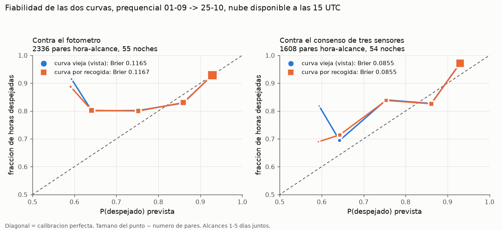
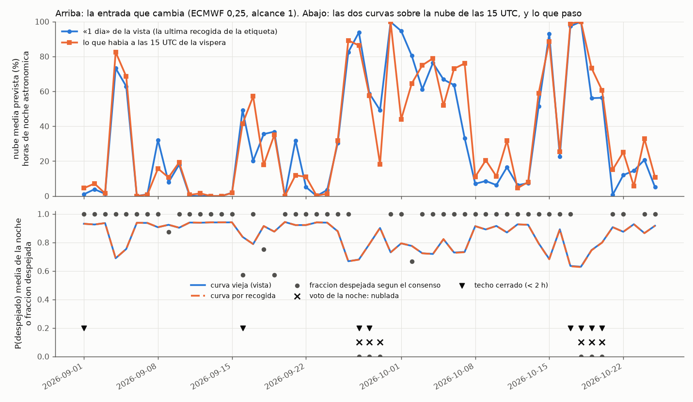

# M16 en la curva del fotómetro: entrenar y examinar con lo que se sabía a las 15 UTC

27-10-2026. Archivo `0e365e96` (2026-10-27T08:34Z), motor `d9fca9c` + este cambio.
Herramienta: `python tools/m16_curva_fotometro.py` (~1,5 min; solo lee el archivo). Cifras
completas en `m16_curva_fotometro/resultados.json`; figuras en `m16_curva_fotometro/`.
Todo intervalo es un IC90 pareado remuestreando noches enteras (2.000 remuestreos), el mismo
del examen `nube_curva`.

## 0. Resumen

1. **El defecto existía y era grande en la entrada.** `calibration.training_rows` metía la
   previsión viva del ECMWF 0,25 por la vista deduplicada con `lead_h // 24`. Su «1 día» de
   una hora de madrugada era la recogida de las 23 UTC de la víspera: el 10 % de esas horas
   se previó **3 h antes** (mediana 20 h). Con la nube que había a las 15 UTC
   (`asof.AsOf.issued`), **cambia la nube en 1.777 de 2.357 pares vivos** (mediana 8 puntos,
   p90 51). Es el control de que hay algo que medir, como los 155 de 275 pares del techo.
2. **El examen del 26-10 23:31Z habría decidido lo mismo.** Reproducido exacto con la vista
   (0,14420 → 0,14181; −0,00239 [−0,00492, +0,00017]; misma aspirante a 4 decimales). Con lo
   publicable: **sustituye**, 0,14502 → 0,14278, −0,00223 [−0,00462, +0,00019]. La aspirante
   que entró de verdad, puntuada con lo publicable, gana por −0,00244. Examen día a día del
   28-09 al 27-10 contra la misma vigente: **la misma decisión 29 de 30 días**; el que cambia
   (09-10) está en el filo del margen (−0,00061 con la vista, −0,00047 por recogida; margen
   0,0005). **WeatherNext no está afectado**: sus filas llevan su pasada de verdad y en
   75.888 pares pasada × hora ninguno cambia de valor entre recogidas. Su decisión
   (0,14308 → 0,14253) se queda como está.
3. **Las dos curvas son la misma curva.** Fuera de muestra (prequencial semanal 01-09 → 25-10,
   puntuadas con la nube de las 15 UTC), la curva por recogida y la vieja difieren en
   **+0,00015 de Brier contra el fotómetro, +0,00005 contra el consenso, −0,00002 contra el
   voto de la noche y −0,00021 contra el techo**. La mayor diferencia de P(despejado) media
   en una noche es **0,0026**; las curvas de hoy difieren como mucho en 0,0017.
4. **Por qué no se nota en la curva, y sí en la evaluación.** En el ENTRENAMIENTO la fuga no
   se ve: lo vivo es el 23 % de los pares, y ni una curva entrenada con la recogida justo
   anterior a cada hora (fuga máxima posible) sale peor (−0,00038 [−0,00080, +0,00002]). Solo
   una fuga perfecta (la nube viva = la verdad) sale en rojo (+0,0034 [+0,0016, +0,0055]). En
   la EVALUACIÓN sí se ve: la misma curva puntuada noche a noche con la nube de la vista
   parece mejor contra el fotómetro por 0,0066 [+0,0017, +0,0127], y su AUC contra el voto
   cae de 0,87 a 0,80 al quitar la fuga.
5. **Decisión: cambiado.** `training_rows` lee lo vivo por recogida (`asof.py`); el examen
   `nube_curva` lo hereda porque puntúa con las mismas filas. La curva no se ha tocado a mano:
   entra por el examen semanal. Arrastra dos medidas: el ranking a 1 día (`modelo_d1`) deja de
   favorecer al ECMWF y a ICON (ECMWF 0,1150 → 0,1172; WeatherNext le saca −0,0046
   [−0,0091, +0,0002] en vez de −0,0035), y la ganancia de la escala nativa de M17 en sep-oct
   aguanta (−0,0022 → −0,0019 [−0,0037, −0,0002]).

## 1. Qué cambia

| | antes (vista) | ahora (por recogida) |
|---|---|---|
| retroanálisis `ecmwf_ifs025_prev<N>d` | por su nombre, alcance N | igual |
| previsión viva `ecmwf_ifs025` | la última recogida de la etiqueta `run_utc` (el día a las 00Z), alcance `lead_h // 24` | la última recogida anterior a las 15 UTC de d días antes de la noche (`AsOf.issued(hora, d)`), d = 1-5 |
| fila viva sin `retrieved_at` | entraba | no entra (no se puede fechar; en el archivo real no hay ninguna) |
| corte de escala M17 | por `run_utc` | igual, también para lo vivo |
| quién lo usa | ajuste de la curva, examen `nube_curva`, `modelo_d1`, `simulate_cloud` | los mismos, sin tocarlos: todos pasan por `model_rows` |

Una recogida vieja (el colector parado) entra con el alcance del corte, igual que la
publicó el producto: 108 de 6.588 pares as-of (1,6 %) vienen de una recogida de más de 24 h
antes del corte (máximo 33 h, el hueco del 29-30 de septiembre); la mediana es 3,0 h y el
p90, 7,6 h.

## 2. ¿Discrimina la comparación? (pregunta 2)

| | n |
|---|---|
| pares de entrenamiento con la vista / por recogida | 10.397 / 10.424 |
| pares vivos con la vista / por recogida | 2.378 / 2.405 |
| pares vivos comunes | 2.357 |
| comunes cuya nube cambia más de medio punto | **1.777** (75 %) |
| solo con la vista / solo por recogida | 21 / 48 |
| diferencia de nube, mediana / p90 | 8 / 51 puntos |
| «1 día» de la vista: horas entre recogida y hora prevista, p10 / p50 / p90 | 3,0 / 20,0 / 27,0 |

La recogida de la vista es MÁS RECIENTE que la del corte de las 15 UTC en el 96 % de los
pares vivos de cada alcance (1 a 5 días) y nunca más vieja: por 17 h de mediana (p10 6 h,
p90 34 h). La nube cruda (1 − nube) sobre los mismos pares, contra el fotómetro: a 1 día la
vista ordena mejor (AUC 0,673 contra 0,603; Brier 0,243 contra 0,281), que es la firma de la
fuga; a 2 y 3 días no se nota (0,607/0,637 y 0,668/0,658): con un otoño de fotómetro, unas
horas más de frescura solo se ven donde la vista llega a 3 h de la hora prevista.

## 3. El examen del 26-10 (paso 1)

`cloud_duel` con `write=False`, vigente = la curva del 30-08 que había esa noche, K = 30,
examen 26-09 → 25-10.

| | vigente | aspirante | dif [IC90] | decisión | aspirante (a, b, c, pares) |
|---|---|---|---|---|---|
| archivado (runner) | 0,14420 | 0,14181 | −0,00239 [−0,00492, +0,00017] | sustituye | 2,7437, −2,2370, −0,0361, 9.045 |
| reproducido con la vista | 0,14420 | 0,14181 | −0,00239 [−0,00492, +0,00017] | sustituye | idéntica |
| **por recogida** | 0,14502 | 0,14278 | **−0,00223 [−0,00462, +0,00019]** | **sustituye** | 2,7535, −2,2466, −0,0389, 9.029 |
| la aspirante real, puntuada por recogida | 0,14502 | 0,14258 | −0,00244 [−0,00495, +0,00011] | sustituye | |

La vista hacía parecer a las dos curvas 0,0008 mejores de lo que eran, y a la aspirante un
poco más (0,00016): estaba ajustada con la misma nube con fuga con la que se la examinaba.
No basta para cambiar la decisión. En el examen día a día (28-09 → 27-10, siempre contra la
vigente del 30-08) la vista favorece a la aspirante entre 0,00001 y 0,00025 (casi siempre
0,00012-0,00021) desde el 02-10; del 28-09 al 01-10, al revés (hasta 0,00013). Eso mueve
una sola decisión, la del 09-10, que estaba en el margen.

## 4. Fuera de muestra (paso 2)

Prequencial semanal: cada semana del 01-09 al 25-10 se puntúa con las dos curvas ajustadas
con TODO lo anterior a esa semana (una con lo vivo de la vista, otra por recogida), siempre
sobre la nube que había a las 15 UTC (lo publicable). Escala nativa (desde el 21-11-2025) en
las dos.

| verdad | alcance | pares | noches | tasa | Brier vieja | Brier recogida | dif [IC90] | AUC vieja / recogida |
|---|---|---|---|---|---|---|---|---|
| fotómetro | 1-5 | 2.336 | 55 | 0,870 | 0,1165 | 0,1167 | +0,00015 [+0,00002, +0,00030] | 0,633 / 0,633 |
| fotómetro | 1 | 473 | 55 | 0,871 | 0,1206 | 0,1208 | +0,00021 [+0,00009, +0,00033] | 0,587 / 0,586 |
| fotómetro | 2 | 473 | 55 | 0,871 | 0,1165 | 0,1167 | +0,00018 [+0,00007, +0,00031] | 0,643 / 0,642 |
| fotómetro | 3 | 473 | 55 | 0,871 | 0,1163 | 0,1165 | +0,00013 [+0,00002, +0,00026] | 0,621 / 0,622 |
| fotómetro | 4 | 465 | 54 | 0,869 | 0,1101 | 0,1102 | +0,00009 [−0,00011, +0,00030] | 0,695 / 0,696 |
| fotómetro | 5 | 452 | 53 | 0,869 | 0,1192 | 0,1193 | +0,00013 [−0,00012, +0,00041] | 0,601 / 0,603 |
| consenso | 1-5 | 1.608 | 54 | 0,897 | 0,0855 | 0,0855 | +0,00005 [−0,00007, +0,00018] | 0,781 / 0,782 |
| consenso | 1 | 326 | 54 | 0,899 | 0,0861 | 0,0862 | +0,00003 [−0,00009, +0,00014] | 0,773 / 0,779 |
| consenso | 2 | 326 | 54 | 0,899 | 0,0787 | 0,0787 | −0,00000 [−0,00013, +0,00012] | 0,847 / 0,847 |
| consenso | 3 | 326 | 54 | 0,899 | 0,0834 | 0,0835 | +0,00006 [−0,00009, +0,00020] | 0,749 / 0,748 |
| consenso | 4 | 319 | 53 | 0,897 | 0,0815 | 0,0816 | +0,00004 [−0,00013, +0,00023] | 0,828 / 0,827 |
| consenso | 5 | 311 | 52 | 0,894 | 0,0980 | 0,0981 | +0,00014 [−0,00001, +0,00034] | 0,705 / 0,707 |
| fotómetro, nube barajada | 1-5 | 2.336 | 55 | 0,870 | 0,1259 | 0,1261 | +0,00016 [+0,00011, +0,00021] | 0,517 / 0,516 |
| fotómetro, puntuadas con la nube de la vista | 1-5 | 2.301 | 55 | 0,872 | 0,1164 | 0,1165 | +0,00012 [+0,00001, +0,00024] | 0,625 / 0,625 |

Lectura:

- Contra el fotómetro la curva por recogida sale 0,00015 peor con un IC90 que no cruza el
  cero. Pero **la misma diferencia (+0,00016) sale con la nube barajada**, donde ninguna
  curva sabe nada: es un desplazamiento de nivel de la curva, no información. Y contra el
  techo cambia de signo (sección 5). Es 30 veces menor que la ganancia de la escala nativa
  (−0,002) y está por debajo del margen del examen (0,0005, el p90 del ruido de reajuste).
- La firma de una fuga en el entrenamiento sería que la curva vieja ganara MÁS al puntuar
  con la nube de la vista (su terreno) que con la publicable. No pasa: +0,00012 con la nube
  de la vista y +0,00015 con la publicable.
- Por construcción, dentro de un mismo alcance las dos curvas ordenan igual (las dos son
  monótonas en la nube): el AUC no puede distinguirlas (pregunta 1). Solo el Brier y la
  fiabilidad.

*Figura 1. Fiabilidad de las dos curvas, prequencial, alcances 1-5, nube de las 15 UTC.
Izquierda: contra el fotómetro. Derecha: contra el consenso de tres sensores. Azul (círculos):
curva vieja; naranja (cuadrados): por recogida. Diagonal = calibración perfecta; tamaño ~
pares.* Las dos curvas se pisan. Lo único que se separa son las casillas con menos de 30
pares (P ≈ 0,59) y la de 0,64 contra el consenso (0,69 contra 0,71): son horas que cruzan el
borde de la casilla por milésimas, no curvas distintas. Las dos son prudentes arriba contra
el consenso (dicen 0,93, pasa el 0,97) y planas contra el fotómetro (entre 0,64 y 0,86 de P
prevista, el cielo estuvo despejado el 80-83 % de las horas): es la curva, no el cambio.

## 5. Contra lo que pasó cada noche (paso 3)

P(despejado) media de las horas de noche astronómica, alcance 1 (la noche siguiente, para lo
que sirve esta curva cuando no hay WeatherNext), las dos curvas prequenciales sobre la nube
de las 15 UTC de la víspera. Verdades de `night_scores` (59 noches puntuadas, 52-55 con
dato desde el 01-09).

| verdad de la noche | noches | tasa | Brier vieja | Brier recogida | dif [IC90] | AUC (las dos) |
|---|---|---|---|---|---|---|
| voto de los tres sensores (despejada) | 52 | 0,885 | 0,0892 | 0,0892 | −0,00002 [−0,00020, +0,00014] | 0,81 |
| fracción despejada del consenso | 54 | 0,860 | 0,0915 | 0,0915 | +0,00002 [−0,00016, +0,00019] | - |
| fracción despejada del fotómetro | 55 | 0,873 | 0,0368 | 0,0369 | +0,00012 [+0,00003, +0,00022] | - |
| techo abrió ≥ 2 h | 46 | 0,826 | 0,1162 | 0,1160 | −0,00021 [−0,00041, −0,00003] | 0,84 |

**Noches en que las dos curvas discrepan**: ninguna de verdad. Las cinco con más diferencia,
todas con nube prevista alta, donde las curvas se separan algo más:

| noche | nube 15 UTC (%) | P vieja | P recogida | dif | voto | consenso | techo | más cerca de lo que pasó |
|---|---|---|---|---|---|---|---|---|
| 18-10 | 100 | 0,6296 | 0,6270 | −0,0026 | nublada | 0,00 | cerrado | recogida (por 0,003) |
| 17-10 | 99 | 0,6350 | 0,6325 | −0,0025 | - | 1,00 | cerrado | vieja contra el consenso, recogida contra el techo |
| 06-10 | 73 | 0,7290 | 0,7268 | −0,0021 | despejada | 1,00 | sin dato | vieja |
| 07-10 | 76 | 0,7333 | 0,7312 | −0,0021 | despejada | 1,00 | sin dato | vieja |
| 15-10 | 88 | 0,6837 | 0,6817 | −0,0020 | despejada | 1,00 | abrió 13 h | vieja |

**Donde sí discrepa algo es en la ENTRADA**: la misma curva (la vigente desde el 26-10) con
el «1 día» de la vista o con lo publicable, noche a noche:

| verdad de la noche | noches | Brier con la nube de la vista | Brier con la nube de las 15 UTC | dif [IC90] | AUC vista / 15 UTC |
|---|---|---|---|---|---|
| voto | 52 | 0,0859 | 0,0903 | +0,0045 [−0,0016, +0,0110] | 0,866 / 0,801 |
| fracción del consenso | 54 | 0,0886 | 0,0922 | +0,0036 [−0,0032, +0,0105] | - |
| fracción del fotómetro | 55 | 0,0306 | 0,0372 | **+0,0066 [+0,0017, +0,0127]** | - |
| techo abrió | 46 | 0,1146 | 0,1150 | +0,0004 [−0,0044, +0,0045] | 0,849 / 0,842 |

Las 10 noches en que el «1 día» de la vista y lo publicable difieren 15 puntos o más de nube
media (figura 2, arriba). «Más cerca» = cuál de las dos P (misma curva) cae más cerca de la
fracción del consenso, del voto y del fotómetro:

| noche | nube vista | nube 15 UTC | P vista | P 15 UTC | voto | consenso | fotómetro | techo | Luna | más cerca (consenso / voto / fotómetro) |
|---|---|---|---|---|---|---|---|---|---|---|
| 08-09 | 32 | 16 | 0,88 | 0,90 | despejada | 1,00 | 1,00 | 11 h | 0,06 | 15 UTC / 15 UTC / 15 UTC |
| 17-09 | 20 | 57 | 0,90 | 0,78 | despejada | 1,00 | 1,00 | 9 h | 0,42 | vista / vista / vista |
| 18-09 | 36 | 18 | 0,86 | 0,91 | despejada | 0,75 | 0,88 | 3 h | 0,51 | vista / 15 UTC / vista |
| 21-09 | 32 | 12 | 0,85 | 0,92 | despejada | 1,00 | 0,75 | 12 h | 0,78 | 15 UTC / 15 UTC / vista |
| 29-09 | 49 | 18 | 0,82 | 0,90 | nublada | 0,00 | 0,33 | sin dato | 0,87 | vista / vista / vista |
| 01-10 | 95 | 44 | 0,64 | 0,84 | - | 1,00 | 0,38 | sin dato | 0,68 | 15 UTC / - / vista |
| 02-10 | 80 | 64 | 0,71 | 0,77 | despejada | 0,67 | 0,70 | sin dato | 0,57 | vista / 15 UTC / vista |
| 07-10 | 33 | 76 | 0,87 | 0,73 | despejada | 1,00 | 1,00 | sin dato | 0,08 | vista / vista / vista |
| 11-10 | 16 | 32 | 0,91 | 0,87 | despejada | 1,00 | 1,00 | 8 h | 0,02 | vista / vista / vista |
| 19-10 | 56 | 73 | 0,80 | 0,74 | nublada | 0,00 | 0,50 | cerrado | 0,62 | 15 UTC / 15 UTC / 15 UTC |

Recuento: contra el fotómetro la vista acierta más 8 de 10 (es la verdad con la que se
entrena y la que más premia la fuga); contra el consenso 6-4 y contra el voto 4-5. La vista
no es un oráculo: siempre es igual o más fresca que lo publicable, y unas veces esa frescura
acierta (29-09, 07-10) y otras no (19-10: la recogida de la noche bajó a 56 % cuando a las
15 UTC de la víspera se decía 73 %, y la noche fue nublada con el techo cerrado).

*Figura 2. Arriba: nube media prevista del ECMWF 0,25 a 1 día en las horas de noche
astronómica, con el «1 día» de la vista (azul, círculos) y con lo que había a las 15 UTC de la
víspera (naranja, cuadrados). Abajo: P(despejado) media de la noche con la curva vieja (azul,
continua) y la curva por recogida (naranja, discontinua) sobre la nube de las 15 UTC;
puntos grises = fracción despejada según el consenso; × = voto «nublada»; ▼ = techo cerrado.*
Las dos líneas de abajo no se separan en ninguna noche; arriba, las diferencias de hasta 51
puntos (01-10) son la entrada que antes se usaba para puntuar.

## 6. Controles en rojo (pregunta 2, el instrumento)

Deja-un-mes-fuera sobre septiembre y octubre (las curvas ajustadas sin el mes, con todo lo
demás: retroanálisis desde el 21-11-2025 y el otro mes vivo), puntuadas con la nube de las
15 UTC contra el fotómetro. 2.394 pares, 57 noches. Referencia: la curva por recogida.

| entrenamiento de lo vivo | Brier | dif contra por recogida [IC90] | curva de octubre (a, b, c) |
|---|---|---|---|
| por recogida | 0,1158 | - | 2,715, −2,193, −0,042 |
| vista | 0,1156 | −0,00021 [−0,00042, −0,00001] | 2,683, −2,155, −0,037 |
| fuga máxima real: la recogida justo antes de cada hora | 0,1154 | −0,00038 [−0,00080, +0,00002] | 2,666, −2,137, −0,032 |
| **fuga perfecta: la nube viva = la verdad (0 / 100 %)** | 0,1192 | **+0,00342 [+0,00157, +0,00546]** | 3,021, −2,682, −0,042 |

El instrumento ve una fuga perfecta (en rojo, también en el prequencial: +0,0038
[+0,0015, +0,0063]) y no ve la fuga máxima que de verdad había en el archivo. No es que el
instrumento sea ciego: es que la nube del ECMWF 0,25 recogida tres horas antes no está más
cerca del fotómetro que la de la víspera lo bastante como para doblar una logística ajustada
con 10.000 pares, tres cuartos de ellos del retroanálisis. Con lo vivo solo (sin
retroanálisis, 1.167-1.226 pares) la curva sí se mueve (pendiente de octubre −0,88 con la
vista contra −1,28 por recogida; de septiembre, −1,82 contra −1,56), pero las dos puntúan
igual: −0,0004 [−0,0023, +0,0015]. Es lo que vendrá con los años, porque el retroanálisis no
crece y lo vivo sí: por eso conviene que lo vivo entre ya bien.

## 7. Lo que arrastra el cambio

**M17, sep-oct** (sección 4.1 de `aprendizaje_continuo.md`; misma cuenta, archivo de hoy):

| nube de lo vivo | pares | Brier vigente 30-08 | Brier nativa | nativa − vigente [IC90] |
|---|---|---|---|---|
| vista (control: el informe de M17 dio −0,0022 [−0,0041, −0,0003]) | 2.363 | 0,1177 | 0,1155 | −0,0022 [−0,0041, −0,0003] |
| por recogida | 2.394 | 0,1178 | 0,1158 | **−0,0019 [−0,0037, −0,0002]** |

El nivel del Brier no es el del informe de M17 (0,1172 / 0,1194, 2.323 pares): el archivo
de hoy trae 40 pares más de octubre. La diferencia, que es lo que importa, sí se reproduce.

**`modelo_d1`** (deja-un-mes-fuera, mismas horas para los tres; el archivo local tiene
WeatherNext solo hasta el 05-10, M14: por eso son 1.438 horas y no las 1.660 del runner):

| | horas / noches | ECMWF 0,25 | ICON | WeatherNext 3 | WeatherNext − ECMWF [IC90] |
|---|---|---|---|---|---|
| vista (reproduce la tabla 4.4 de `aprendizaje_continuo.md`) | 1.438 / 200 | 0,1150 (AUC 0,795) | 0,1159 (0,772) | 0,1115 (0,813) | −0,0035 [−0,0077, +0,0008] |
| **por recogida** | 1.438 / 199 | 0,1172 (0,786) | 0,1186 (0,760) | 0,1126 (0,813) | **−0,0046 [−0,0091, +0,0002]** |

El «1 día» del ECMWF y de ICON en vivo tenía la misma fuga; WeatherNext, no. Quitada, la
ventaja de WeatherNext a 1 día crece un tercio y casi sale del ruido. Sigue siendo solo una
medida: el producto no cambia de modelo.

## 8. Las seis preguntas

1. **¿Puede la métrica ver el efecto?** El AUC no: dentro de un alcance las dos curvas son
   monótonas en la nube y ordenan igual. El Brier y la fiabilidad sí, y la diferencia que
   pueden ver está acotada por lo que se mueve la curva (≤ 0,003 de probabilidad).
2. **¿La he visto fallar?** Sí: la fuga perfecta sale en rojo (+0,0034 y +0,0038); la nube
   de la vista puntuando a la misma curva sale en rojo contra el fotómetro (+0,0066); los
   tests nuevos fallaron con el código anterior (la vista daba al examen un Brier de 0,78
   donde lo publicable da 0,03). La fuga máxima real NO sale en rojo: por eso no digo que la
   curva vieja estuviera estropeada, solo que se entrenaba y examinaba con una nube que
   nadie pudo publicar.
3. **¿Se ejecutó?** La reproducción del examen archivado da la misma aspirante a 4
   decimales; `training_rows` nuevo da exactamente las 10.424 filas del prototipo; las
   filas viejas (`legacy_rows`) dan exactamente las 10.397 de producción; las figuras se
   generaron y se miraron.
4. **¿De dónde salen las constantes?** Las 15 UTC del corte (`asof.ISSUE_CUTOFF_HOUR_UTC`)
   son supuestas, no medidas (informe del 26-10, sección 9), y aquí se heredan. Los
   alcances 1-5 son los del retroanálisis. El margen del examen (0,0005) es el medido en
   `aprendizaje_continuo.md` 4.2 con la vista; con filas por recogida no se ha re-medido
   (ver pendientes).
5. **¿El mecanismo explica la escala?** Sí: 1.777 pares cambian, pero son el 17 % del
   entrenamiento, la nube recogida 3 h antes casi no informa más que la de la víspera contra
   el fotómetro (AUC 0,67 contra 0,60 a 1 día, 0,61 contra 0,64 a 2), y el resultado es una
   curva que se mueve 0,002. La evaluación sí se mueve (0,0008 en el examen; 0,0066 noche a
   noche) porque ahí la nube con fuga entra directamente en cada puntuación.
6. **¿Estoy suavizando la señal?** La P de la noche es la media de sus horas: aplana. Por
   eso todo está también hora a hora (sección 4). El consenso esconde desacuerdos: cada
   verdad tiene su fila.

## 9. Refutado (no repetir)

- «La curva del fotómetro estaba inflada por la fuga de la vista»: no. Fuera de muestra,
  vieja y por recogida difieren en ±0,0002 de Brier según la verdad, con el mismo
  desplazamiento con la nube barajada, y en ≤ 0,003 de probabilidad.
- «El examen del 26-10 sustituyó la curva por la fuga»: no. Con lo publicable también
  sustituye (−0,00223); la aspirante que entró gana por −0,00244 puntuada honestamente.
- «Entrenar con la recogida más fresca (nowcast) estropea la curva»: no se ve
  (−0,00038 [−0,00080, +0,00002]); solo una fuga perfecta se ve.
- «La fuga de la vista solo está en el alcance 1»: no; en los cinco alcances su recogida es
  más reciente que el corte en el 96 % de los pares (17 h de mediana). Solo a 1 día se nota
  en el acierto de la nube cruda (sección 2).

## 10. Medido, plausible, no verificado

- **Medido**: todas las tablas; la reproducción del examen archivado; las decisiones día a
  día; la estabilidad de WeatherNext entre recogidas (0 de 75.888).
- **Plausible**: que el +0,00015 contra el fotómetro sea solo nivel (lo apoya el barajado y
  el cambio de signo contra el techo; no está desglosado).
- **NO VERIFICADO**: que el margen 0,0005 y K = 30 del examen sigan siendo los mejores con
  filas por recogida (se midieron con la vista; el ruido de reajuste debería ser parecido
  porque las curvas casi no cambian); el corte de las 15 UTC como hora real de publicación.
- **Fuera de este cambio, a propósito**: alcance 0 (esta noche) en el entrenamiento — el
  retroanálisis no lo tiene y el producto usa la curva del techo esta noche; M3 (entrenar
  contra el voto de sensores).
