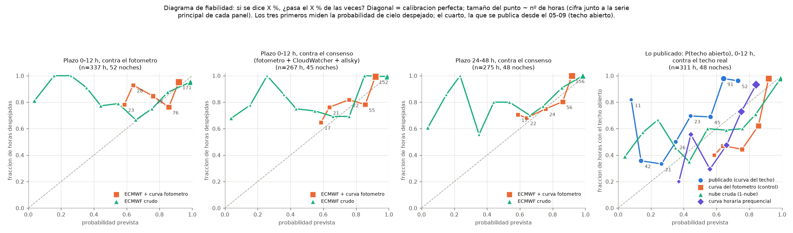
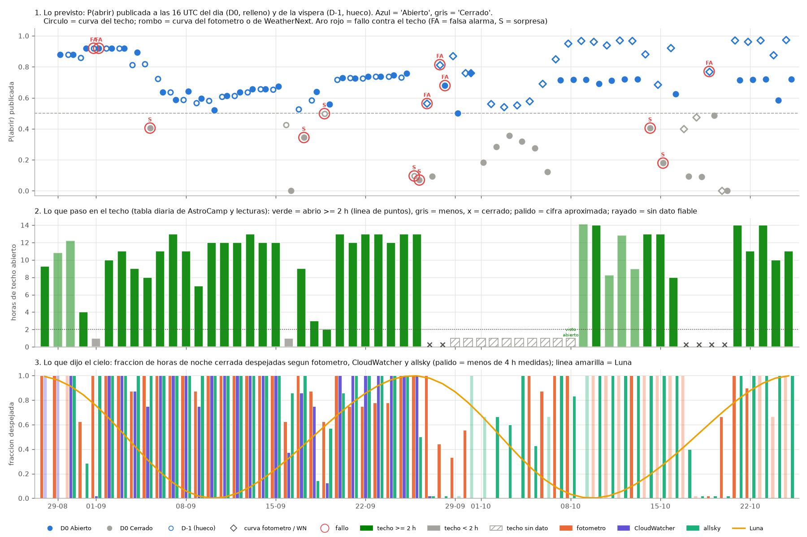
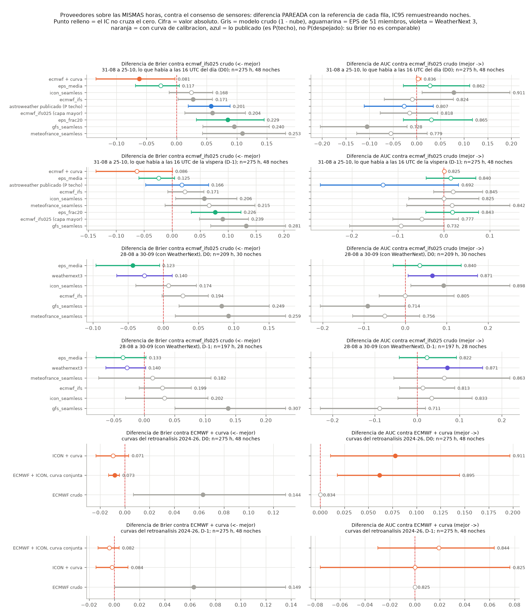
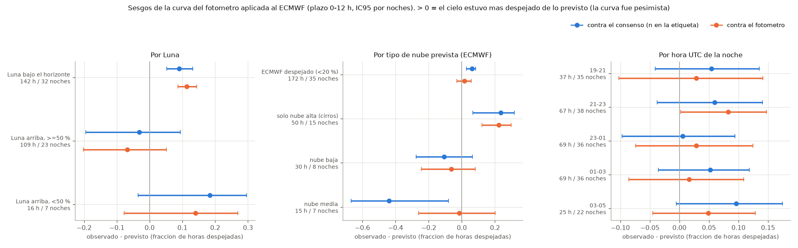

# Lo que previmos contra lo que pasó — AstroCamp, noches del 28-08 al 25-10-2026

Generado por `python -m astroweather.hindcast` el 2026-10-26 17:43 UTC sobre el archivo `7eff6f5d 2026-10-26T14:15:49Z` y el repo de datos `278a50f 2026-10-26T14:15:35Z`; 2000 remuestreos por noches en cada intervalo. Cifras en `verificacion_2026-10-26/resultados.json`.

Todo intervalo es un IC95 remuestreando NOCHES enteras. Con ~50 noches, una diferencia cuyo IC cruza el cero no se da por buena aquí, aunque el punto parezca mejor.

## 0. Resumen

1. **El veredicto de la noche acierta lo que acertaría decir siempre «Abierto».** Desde el 05-09 (regla actual), a las 16 UTC del día: 42 noches con techo conocido, 30 aciertos, 1 falsa(s) alarma(s), 5 sorpresas, 6 cierres bien dichos: acierto 0.86 [0.74, 0.95] contra 0.83 de «siempre Abierto» y 0.88 de «como anoche». Discrimina (AUC 0.89 [0.69, 1.00]), pero la probabilidad publicada está hundida: media 0.55 cuando el techo abrió el 83% de las noches (Brier 0.160 contra 0.139 de la climatología).
2. **La causa principal está medida: la curva del techo no puede pasar de 61%-77%** ni con 0 % de nube (cruce en el 30% fijado por los meses). Hora a hora, cuando dice 0.64-0.73 el techo estaba abierto el 96%-98% de las horas. Las horas esperadas publicadas se quedan cortas en 3.6 h por noche (5.7 contra 9.2 reales).
3. **Arreglo validado sin fuga:** la misma regla con una curva horaria reajustada noche a noche solo con las noches anteriores baja el Brier del veredicto de 0.155 a 0.088 (diferencia pareada -0.067 [-0.110, -0.023], 41 noches), con el mismo acierto.
4. **La verdad del fotómetro no sirve sola para puntuar nubes en este periodo.** Contra el CloudWatcher, de 41 horas nubladas el fotómetro llamó despejadas 32 (κ = 0.22; con la allsky κ = 0.26). Falla en las dos direcciones y siempre con la Luna: 27-09 cubierto total con Luna llena, 9 de 9 horas «despejadas»; 21-25-09 Luna baja, cielo limpio (1.000-1.500 estrellas), horas «nubladas». Contra el consenso de tres sensores el ECMWF ordena las horas con AUC 0.82 [0.67, 0.93]; contra el fotómetro solo, 0.65 [0.53, 0.76].
5. **La probabilidad horaria de despejado (ECMWF + curva del fotómetro) no bate a la climatología con claridad**: BSS +8.7 [-40.9, +27.5] % contra el consenso a 0-12 h, -6.0 [-33.3, +6.9] % contra el fotómetro. Sí mejora mucho al ECMWF crudo (BSS +50.0 [+30.7, +64.7] %). Su recorrido es 0.58-0.92: nunca dice «probablemente nublado».
6. **ICON calibrado ordena mejor que el ECMWF calibrado a D0, fuera de muestra; a D-1 no.** Curvas ajustadas en el retroanálisis 2024-26 y puntuadas con lo que había a las 16 UTC: a D0 contra el consenso, AUC 0.078 [0.011, 0.197] y Brier -0.009 [-0.023, 0.003]; contra el fotómetro, Brier -0.016 [-0.028, -0.004]; a D-1 contra el consenso, AUC 0.000 [-0.076, 0.076].
7. **El sesgo sistemático más grande es el tipo de nube.** Con solo nube alta prevista (capas del ECMWF de 9 km) el cielo estuvo despejado el 94% de las horas y la curva decía 71% (la publicada, 29%); con nube media prevista, 27% contra 71%. 3 de las 7 noches falladas del D0 son cirros previstos con el techo abierto toda la noche.
8. **El archivo de proveedores mezcla pasadas bajo una misma etiqueta, y eso mete retrospectiva** en quien lo lea por la vista deduplicada: `run_utc` es el día a las 00Z, pero cada recogida trae la pasada más reciente y la vista se queda con la de las 21-23 UTC. Reconstruyendo recogida a recogida, la nube que usó el producto casa en el 100% de 1979 horas; la vista, solo en el 56%. La curva del techo se entrena así (`roofcalibration.py:222`). Y el ECMWF de 0,25° trae una nube total por debajo de su propia capa mayor en el 50% de las filas.
9. **Huecos que limitan todo lo anterior:** desde el 30-09 el colector solo lee el techo y el CloudWatcher 2-3 veces por noche (octubre: 45 lecturas de techo contra 608 en septiembre; 18 horas de CloudWatcher); el fotómetro de octubre cubre 103 de 245 horas oscuras por un fallo de `top_up` recuperable; WeatherNext de octubre no está en el archivo (se agrupa al cerrar el mes); seeing y AOD no tienen verdad. 9 noches (29-09 a 07-10) quedan sin verdad de techo.

Lista de mejoras: sección 10 (M1-M18). Figuras: `verificacion_2026-10-26/calendario.png` (noche a noche), `verificacion_2026-10-26/fiabilidad.png`, `verificacion_2026-10-26/proveedores.png`, `verificacion_2026-10-26/sesgos.png`.

## 1. Qué se comparó y con qué

**Lo previsto.** (1) Las 5.093 filas `model='astroweather'` del archivo: la probabilidad horaria que salió en cada pasada, con la curva vigente ese día. (2) Las 216 versiones de `noche.json` en el historial del repo de datos (2026-08-29 a 2026-10-26): lo que vio el usuario (probabilidad de abrir, veredicto, ventana, horas esperadas, terciles). (3) Los proveedores archivados en el mismo periodo.

**Deduplicación.** Una predicción por hora y franja de plazo (0-12, 12-24, 24-48 h desde la emisión): la última emitida dentro de la franja. Por noche: la publicación vigente a las 16 UTC del día (D0) y la de la víspera (D-1). Proveedores: lo que había en el archivo a esas mismas horas, reconstruido recogida a recogida (sección 1 bis).

**Tres magnitudes distintas bajo el mismo nombre.** La columna `p_calibrated` (y `p_despejado` en la web) fue P(despejado) contra el fotómetro hasta el 04-09; desde entonces, para esta noche, P(techo abierto); desde el 25-09, para la noche siguiente, P(despejado) de WeatherNext. La etiqueta `provider_model_version` solo nombra la curva del fotómetro, así que el régimen se reconstruyó comparando cada número con lo que daba cada curva vigente (historial git): fotometro 633 filas, techo 3170 filas, weathernext 1290 filas; error p99 de la reconstrucción 0.0061. Comparar el Brier de una P(techo) con una verdad de nubes no tiene sentido: en esas tablas solo vale su AUC.

| mes | noches | horas oscuras | fotómetro | CloudWatcher | allsky | consenso | lecturas de techo |
|---|---|---|---|---|---|---|---|
| 2026-08 | 4 | 32 | 27 | 9 | 13 | 13 | 98 |
| 2026-09 | 30 | 258 | 248 | 223 | 200 | 223 | 608 |
| 2026-10 | 25 | 245 | 103 | 18 | 128 | 46 | 45 |

## 1 bis. Qué había en el archivo en cada momento

Para los modelos de Open-Meteo, `run_utc` es el primer instante de la serie pedida (`workers/fetch_forecast.py:101`: el día a las 00Z), no la hora de inicialización. Cada recogida del día trae la pasada más reciente que sirve Open-Meteo y la vista deduplicada (`queries.py:52`) se queda con la última, la de las 21-23 UTC. Ejemplo, hora 22 UTC del 17-09: la «pasada del 17-09» del ECMWF de 0,25° vale 69, 65, 17 y 12 % de nube según se recogiera a las 02, 10, 16 o 23 UTC. Leerla por la etiqueta es leer el futuro.

Este informe lee el Parquet crudo y reconstruye lo que había en cada instante (la recogida más reciente anterior). **Control positivo**: en las 1979 horas en que el producto usó el ECMWF, la nube archivada con nuestra predicción y la reconstruida coinciden en el 100.0% (mediana de la diferencia 0.0 puntos); la vista deduplicada habría coincidido en el 56.3%. WeatherNext lleva su inicialización de verdad pero agosto y septiembre llegaron con un relleno: su disponibilidad se fecha como inicialización + 7 h (supuesto, NO medido). Los proveedores se comparan con lo que había a las 16 UTC.

Coherencia interna de cada proveedor (fracción de filas con la nube total por debajo de su capa mayor, imposible con cualquier regla de solape): ecmwf_ifs025 50.0% (n=30912), ecmwf_ifs 2.0% (n=33168), icon_seamless 0.1% (n=30912), gfs_seamless 0.3% (n=30912). El 0,25° del ECMWF, que es la nube del producto, no casa con sus capas; por eso los cortes por tipo de nube usan las capas del ECMWF de 9 km. Qué variable sirve Open-Meteo como total del 0,25°: NO VERIFICADO.

## 2. Antes de puntuar: validar las verdades

Pregunta 1 de las seis: ¿puede la verdad, por construcción, ver lo que se le pide? Se cruzaron tres sensores independientes hora a hora (noche cerrada, Sol < −18°):

| par | Luna | horas | κ | ambos nublado | solo el 2º nublado | solo el 1º nublado | ambos despejado |
|---|---|---|---|---|---|---|---|
| fotometro vs cloudwatcher | todas | 240 | 0.22 | 9 | 32 | 10 | 189 |
| fotometro vs cloudwatcher | Luna arriba, <50 % | 14 | 1.00 | 1 | 0 | 0 | 13 |
| fotometro vs cloudwatcher | Luna arriba, >=50 % | 96 | 0.07 | 4 | 18 | 9 | 65 |
| fotometro vs cloudwatcher | Luna bajo el horizonte | 130 | 0.31 | 4 | 14 | 1 | 111 |
| fotometro vs allsky | todas | 250 | 0.26 | 13 | 32 | 14 | 191 |
| fotometro vs allsky | Luna arriba, <50 % | 12 | 0.00 | 0 | 0 | 1 | 11 |
| fotometro vs allsky | Luna bajo el horizonte | 130 | -0.05 | 0 | 13 | 4 | 113 |
| fotometro vs allsky | Luna arriba, >=50 % | 108 | 0.32 | 13 | 19 | 9 | 67 |
| cloudwatcher vs allsky | todas | 192 | 0.34 | 11 | 11 | 19 | 151 |
| cloudwatcher vs allsky | Luna arriba, <50 % | 10 | 0.00 | 0 | 0 | 1 | 9 |
| cloudwatcher vs allsky | Luna bajo el horizonte | 105 | 0.11 | 2 | 5 | 12 | 86 |
| cloudwatcher vs allsky | Luna arriba, >=50 % | 77 | 0.50 | 9 | 6 | 6 | 56 |

Lectura (columnas: «solo el 2º nublado» = el segundo sensor dice nublado y el primero despejado). Casos mirados uno a uno en el archivo:

- **Fotómetro, falso despejado con Luna llena y nube gruesa**: 27/28-09, CloudWatcher a −2/−6 °C de cielo, allsky 0-34 estrellas, ECMWF 88-98 % de nube, techo cerrado; el fotómetro, 9 de 9 horas «despejadas». La nube devuelve un cielo tan brillante como el que predice el modelo lunar y pasa el corte de nivel (`CLEAR_LEVEL_TOLERANCE` = 0,511).
- **Fotómetro, falso nublado con Luna baja**: 21-25-09, Luna a 7-21° de altura, CloudWatcher despejado, allsky 960-1.570 estrellas, ECMWF 0 %; el fotómetro, nublado. Es el error del modelo lunar cerca del horizonte que `calibration.py` ya declaraba.
- **CloudWatcher, falso nublado con cielo cálido**: 01-09, cielo IR a −5/−8 °C toda la noche, allsky ~400 estrellas con Luna al 75 %, fotómetro despejado, ECMWF 0-13 %. El techo NO abrió (1 h): AstroCamp decide con este sensor. Causa NO VERIFICADA (humedad o calima; no hay PM2.5 esa noche).
- **Allsky**: 0 estrellas desde las 03 UTC todas las noches (no es nube; mediana 0 en las 15 noches limpias), así que solo cuenta de 19 a 03 UTC. Umbral: 100 estrellas, el valle de su distribución: 0-30: 40 h, 30-100: 26 h, 100-300: 46 h, 300-∞: 229 h. Con Luna llena alta y cirros baja de 100 (26-09) aunque el techo estuvo abierto.

**Consenso** = mayoría de las disponibles, con al menos dos y sin empate (282 horas, 90% despejadas). Es un constructo y se declara: cada tabla va también contra el fotómetro solo, que es la verdad con la que se entrena el producto.

**Verdad del techo, control positivo.** La tabla diaria de AstroCamp (diferencias entre versiones del historial git) contra las lecturas cada 30 min, en las 26 noches de septiembre con las dos: r = 0.987, MAE 0.71 h, sesgo +0.55 h (la tabla cuenta algo más), y la misma decisión «abrió ≥ 2 h» en 24 de 26. Las dos fuentes se validan entre sí; en octubre solo queda la tabla.

**Controles del puntuador contra el fotometro** (franja 0-12 h): la misma previsión con las horas barajadas debe salir peor, y la verdad misma, perfecta.

| previsión | Brier [IC95] | AUC [IC95] | BSS vs clim. de la muestra (%) | BSS vs - (%) | p media |
|---|---|---|---|---|---|
| ECMWF + curva fotometro | 0.108 [0.077, 0.144] | 0.643 [0.525, 0.759] | -6.0 [-33.3, +6.9] | - | 0.84 |
| la misma, barajada | 0.117 [0.082, 0.155] | 0.490 [0.385, 0.605] | -13.9 [-34.0, -4.6] | - | 0.84 |
| verdad (perfecta) | 0.000 [0.000, 0.000] | 1.000 [1.000, 1.000] | +100.0 [+100.0, +100.0] | - | 0.88 |
| climatologia de la muestra | 0.102 [0.065, 0.146] | 0.500 [0.500, 0.500] | +0.0 [-4.2, -0.0] | - | 0.88 |

La previsión real: AUC 0.64 y Brier 0.108; barajada: AUC 0.49 y Brier 0.117. Los IC del AUC se solapan y en Brier no se distinguen: **contra esta verdad la previsión apenas se separa de su propio barajado**, y eso es un fallo de la verdad tanto como de la previsión (sección 2).

**Controles del puntuador contra el consenso** (franja 0-12 h): la misma previsión con las horas barajadas debe salir peor, y la verdad misma, perfecta.

| previsión | Brier [IC95] | AUC [IC95] | BSS vs clim. de la muestra (%) | BSS vs - (%) | p media |
|---|---|---|---|---|---|
| ECMWF + curva fotometro | 0.086 [0.050, 0.128] | 0.817 [0.665, 0.926] | +8.7 [-40.9, +27.5] | - | 0.85 |
| la misma, barajada | 0.105 [0.062, 0.160] | 0.527 [0.387, 0.649] | -11.8 [-57.2, +0.1] | - | 0.85 |
| verdad (perfecta) | 0.000 [0.000, 0.000] | 1.000 [1.000, 1.000] | +100.0 [+100.0, +100.0] | - | 0.90 |
| climatologia de la muestra | 0.094 [0.044, 0.160] | 0.500 [0.500, 0.500] | +0.0 [-10.3, -0.0] | - | 0.90 |

La previsión real: AUC 0.82 y Brier 0.086; barajada: AUC 0.53 y Brier 0.105. Los IC del AUC no se tocan: contra esta verdad la previsión se distingue de su propio azar.

## 3. (a) Probabilidad horaria de despejado, por plazo

«ECMWF + curva fotómetro» es la curva del 30-08 (la que el producto usó hasta el 04-09 y la base de todo lo demás) sobre la pasada del ECMWF que había al emitir: es la previsión de NUBE del motor, fuera de muestra desde el 31-08. «Publicado» es lo archivado (sobre todo P(techo)). «Climatología previa»: fracción despejada del mismo mes en 2024-08 → 2026-07 según el fotómetro.

**Contra el fotometro, plazo 0-12 h** — 337 h, 52 noches, tasa base 0.88; regímenes de lo publicado: fotometro 36, techo 301

| previsión | Brier [IC95] | AUC [IC95] | BSS vs clim. de la muestra (%) | BSS vs ECMWF crudo (%) | p media |
|---|---|---|---|---|---|
| publicado | 0.262 [0.207, 0.325] | 0.581 [0.428, 0.722] | -156.1 [-340.9, -71.2] | -20.9 [-43.4, -6.9] | 0.54 |
| ECMWF + curva fotometro | 0.108 [0.077, 0.144] | 0.643 [0.525, 0.759] | -6.0 [-33.3, +6.9] | +50.0 [+30.7, +64.7] | 0.84 |
| ECMWF crudo | 0.217 [0.150, 0.295] | 0.650 [0.534, 0.763] | -111.9 [-269.9, -37.7] | - | 0.72 |
| climatologia previa | 0.107 [0.076, 0.142] | 0.531 [0.409, 0.659] | -4.6 [-22.6, +2.6] | +50.6 [+25.7, +69.1] | 0.83 |

**Contra el fotometro, plazo 12-24 h** — 350 h, 54 noches, tasa base 0.87; regímenes de lo publicado: fotometro 40, techo 309, weathernext 1

| previsión | Brier [IC95] | AUC [IC95] | BSS vs clim. de la muestra (%) | BSS vs ECMWF crudo (%) | p media |
|---|---|---|---|---|---|
| publicado | 0.263 [0.205, 0.322] | 0.597 [0.457, 0.724] | -135.0 [-291.7, -61.5] | -20.7 [-41.3, -8.2] | 0.54 |
| ECMWF + curva fotometro | 0.115 [0.079, 0.153] | 0.667 [0.555, 0.775] | -2.7 [-24.2, +9.4] | +47.3 [+28.2, +62.0] | 0.84 |
| ECMWF crudo | 0.218 [0.152, 0.287] | 0.661 [0.549, 0.770] | -94.7 [-222.7, -32.0] | - | 0.71 |
| climatologia previa | 0.116 [0.082, 0.156] | 0.505 [0.399, 0.638] | -3.9 [-18.7, +1.8] | +46.6 [+22.8, +64.6] | 0.82 |

**Contra el fotometro, plazo 24-48 h** — 358 h, 54 noches, tasa base 0.87; regímenes de lo publicado: fotometro 43, techo 180, weathernext 135

| previsión | Brier [IC95] | AUC [IC95] | BSS vs clim. de la muestra (%) | BSS vs ECMWF crudo (%) | p media |
|---|---|---|---|---|---|
| publicado | 0.191 [0.148, 0.230] | 0.517 [0.398, 0.651] | -64.6 [-137.9, -29.4] | +18.8 [-4.7, +35.4] | 0.68 |
| ECMWF + curva fotometro | 0.120 [0.083, 0.157] | 0.665 [0.571, 0.771] | -3.1 [-23.9, +7.8] | +49.1 [+32.4, +62.4] | 0.83 |
| ECMWF crudo | 0.235 [0.162, 0.310] | 0.658 [0.555, 0.765] | -102.6 [-226.6, -40.6] | - | 0.69 |
| climatologia previa | 0.120 [0.085, 0.158] | 0.504 [0.403, 0.627] | -3.5 [-17.6, +1.8] | +48.9 [+26.7, +65.9] | 0.82 |

**Contra el consenso, plazo 0-12 h** — 267 h, 45 noches, tasa base 0.90; regímenes de lo publicado: fotometro 33, techo 234

| previsión | Brier [IC95] | AUC [IC95] | BSS vs clim. de la muestra (%) | BSS vs ECMWF crudo (%) | p media |
|---|---|---|---|---|---|
| publicado | 0.212 [0.151, 0.287] | 0.796 [0.609, 0.925] | -125.3 [-452.5, -21.1] | -36.0 [-96.8, -9.0] | 0.56 |
| ECMWF + curva fotometro | 0.086 [0.050, 0.128] | 0.817 [0.665, 0.926] | +8.7 [-40.9, +27.5] | +44.9 [-1.3, +66.4] | 0.85 |
| ECMWF crudo | 0.156 [0.079, 0.251] | 0.822 [0.672, 0.927] | -65.7 [-322.6, +25.2] | - | 0.75 |

**Contra el consenso, plazo 12-24 h** — 272 h, 47 noches, tasa base 0.89; regímenes de lo publicado: fotometro 37, techo 234, weathernext 1

| previsión | Brier [IC95] | AUC [IC95] | BSS vs clim. de la muestra (%) | BSS vs ECMWF crudo (%) | p media |
|---|---|---|---|---|---|
| publicado | 0.208 [0.153, 0.273] | 0.795 [0.594, 0.923] | -118.7 [-422.5, -19.3] | -43.0 [-91.9, -16.3] | 0.56 |
| ECMWF + curva fotometro | 0.084 [0.051, 0.124] | 0.826 [0.673, 0.925] | +12.2 [-31.0, +28.0] | +42.6 [+2.2, +64.6] | 0.85 |
| ECMWF crudo | 0.146 [0.086, 0.219] | 0.825 [0.670, 0.925] | -52.9 [-270.6, +24.1] | - | 0.75 |

**Contra el consenso, plazo 24-48 h** — 275 h, 48 noches, tasa base 0.89; regímenes de lo publicado: fotometro 39, techo 170, weathernext 66

| previsión | Brier [IC95] | AUC [IC95] | BSS vs clim. de la muestra (%) | BSS vs ECMWF crudo (%) | p media |
|---|---|---|---|---|---|
| publicado | 0.168 [0.130, 0.210] | 0.685 [0.517, 0.830] | -78.3 [-272.6, -16.8] | -16.7 [-91.6, +20.5] | 0.66 |
| ECMWF + curva fotometro | 0.083 [0.049, 0.123] | 0.856 [0.738, 0.936] | +12.5 [-32.3, +29.4] | +42.7 [-1.2, +66.2] | 0.85 |
| ECMWF crudo | 0.144 [0.077, 0.224] | 0.856 [0.738, 0.936] | -52.8 [-283.7, +28.1] | - | 0.75 |

Contra cada sensor por separado, solo la previsión de nube (ECMWF + curva):

| verdad | plazo | horas | noches | tasa base | Brier | AUC | BSS vs clim. (%) |
|---|---|---|---|---|---|---|---|
| fotometro | 0-12 h | 337 | 52 | 0.88 | 0.108 [0.077, 0.144] | 0.643 [0.525, 0.759] | -6.0 [-33.3, +6.9] |
| fotometro | 12-24 h | 350 | 54 | 0.87 | 0.115 [0.079, 0.153] | 0.667 [0.555, 0.775] | -2.7 [-24.2, +9.4] |
| fotometro | 24-48 h | 358 | 54 | 0.87 | 0.120 [0.083, 0.157] | 0.665 [0.571, 0.771] | -3.1 [-23.9, +7.8] |
| consenso | 0-12 h | 267 | 45 | 0.90 | 0.086 [0.050, 0.128] | 0.817 [0.665, 0.926] | +8.7 [-40.9, +27.5] |
| consenso | 12-24 h | 272 | 47 | 0.89 | 0.084 [0.051, 0.124] | 0.826 [0.673, 0.925] | +12.2 [-31.0, +28.0] |
| consenso | 24-48 h | 275 | 48 | 0.89 | 0.083 [0.049, 0.123] | 0.856 [0.738, 0.936] | +12.5 [-32.3, +29.4] |
| cloudwatcher | 0-12 h | 241 | 44 | 0.82 | 0.133 [0.070, 0.212] | 0.738 [0.541, 0.915] | +9.1 [-14.4, +25.7] |
| cloudwatcher | 12-24 h | 243 | 46 | 0.82 | 0.128 [0.065, 0.209] | 0.742 [0.519, 0.922] | +11.8 [-9.1, +26.6] |
| cloudwatcher | 24-48 h | 243 | 46 | 0.82 | 0.126 [0.063, 0.208] | 0.781 [0.596, 0.935] | +13.7 [-8.6, +29.9] |
| allsky | 0-12 h | 330 | 55 | 0.81 | 0.136 [0.088, 0.189] | 0.780 [0.668, 0.874] | +13.2 [-1.1, +23.5] |
| allsky | 12-24 h | 335 | 56 | 0.80 | 0.139 [0.093, 0.192] | 0.762 [0.640, 0.865] | +12.0 [-2.0, +22.5] |
| allsky | 24-48 h | 335 | 56 | 0.81 | 0.130 [0.086, 0.181] | 0.823 [0.730, 0.899] | +16.6 [+4.0, +25.8] |

*Figura 1. Diagrama de fiabilidad. Paneles 1-3: probabilidad de cielo despejado (naranja: ECMWF + curva del fotómetro; verde: ECMWF crudo, 1 − nube) contra el fotómetro y contra el consenso. Panel 4: lo que se publica desde el 05-09, P(techo abierto), contra el techo real hora a hora (azul), con la curva del fotómetro como control (naranja) y la curva horaria prequencial (violeta). Diagonal = calibración perfecta; tamaño ~ nº de horas.*

Lo que dice la figura, medido: la curva del fotómetro vive entre 0.58 y 0.92; contra el consenso, su casilla alta (0.92, 152 h) acierta el 99%: es demasiado prudente arriba. El ECMWF crudo está mal calibrado (en su casilla de 0-10 % de «despejado» el cielo estuvo despejado el 81%/68% de las horas, fotómetro/consenso), que es para lo que existe la curva.

**Lo publicado contra lo que pretende predecir: el techo, hora a hora** (311 h de 18 a 05 UTC con lecturas, 48 noches, 2026-09-05 a 2026-10-25; tasa base 0.74):

| previsión | Brier [IC95] | AUC [IC95] | BSS vs clim. de la muestra (%) | BSS vs - (%) | p media |
|---|---|---|---|---|---|
| publicado (curva del techo) | 0.207 [0.160, 0.271] | 0.822 [0.702, 0.917] | -7.6 [-81.8, +25.7] | - | 0.49 |
| curva del fotometro (control) | 0.168 [0.100, 0.243] | 0.836 [0.725, 0.919] | +12.6 [-4.7, +24.0] | - | 0.83 |
| nube cruda (1-nube) | 0.164 [0.101, 0.247] | 0.831 [0.718, 0.917] | +14.6 [-42.1, +43.6] | - | 0.69 |

La curva del techo ordena bien (AUC 0.82) pero está hundida: p media 0.49 contra un techo abierto el 74% de esas horas. El control del 05-09 se reproduce en rojo: la curva del fotómetro es optimista en la zona media (dice 0.59-0.86 y el techo abre el 40%-62%).

**Curva horaria prequencial** (logística de dos parámetros reajustada cada noche solo con las horas de techo de las noches anteriores, desde la 8ª): Brier 0.162 [0.108, 0.225] contra 0.193 [0.145, 0.257] publicado (diferencia -0.031 [-0.096, 0.038]); AUC -0.054 [-0.103, -0.011] peor, porque las primeras curvas eran casi planas. Su última versión (2026-10-25): P(0 % de nube) = 0.86 y cruce del 50 % en 72% de nube, contra 0.77 y 30% de la curva publicada. Las horas dicen que el cruce mensual del 30 % es demasiado bajo para este otoño.

**WeatherNext calibrado, fuera de muestra** (noche siguiente, 25-09 → 25-10, plazo 24-48 h, contra el consenso, 66 h, 20 noches): lo publicado con su curva, Brier 0.138 [0.056, 0.238] y AUC 0.914 [0.755, 0.990], contra ECMWF + curva 0.163 [0.069, 0.279] y 0.828 [0.582, 0.961]. Mejor en el punto, dentro del ruido en Brier.

## 4. (b) El veredicto publicado contra lo que hizo AstroCamp

Verdad: «abrió» = techo abierto ≥ 2 h (la ventana de dos horas que promete «Abierto»), de la tabla diaria de AstroCamp; donde no, de las lecturas. Para las noches sin regla escrita (antes del 05-09) el veredicto se deriva como p ≥ 0,5.

| conjunto | noches | aciertos | falsas alarmas | sorpresas | cerradas bien | acierto [IC95] | 'siempre Abierto' | persistencia (mismas noches) | HSS [IC95] | Brier [IC95] | Brier clim. | AUC [IC95] | p media / abrió |
|---|---|---|---|---|---|---|---|---|---|---|---|---|---|
| D0 todo | 49 | 36 | 2 | 5 | 6 | 0.86 [0.76, 0.94] | 0.84 | 0.85 vs 0.85 (n=48) | 0.55 [0.22, 0.82] | 0.155 [0.106, 0.214] | 0.137 | 0.80 [0.52, 0.99] | 0.60 / 0.84 |
| D0 desde 05-09 | 42 | 30 | 1 | 5 | 6 | 0.86 [0.74, 0.95] | 0.83 | 0.88 vs 0.85 (n=41) | 0.58 [0.24, 0.85] | 0.160 [0.110, 0.216] | 0.139 | 0.89 [0.69, 1.00] | 0.55 / 0.83 |
| D-1 todo | 48 | 38 | 4 | 2 | 4 | 0.88 [0.77, 0.96] | 0.83 | 0.85 vs 0.87 (n=47) | 0.50 [0.11, 0.81] | 0.137 [0.086, 0.196] | 0.139 | 0.76 [0.54, 0.98] | 0.73 / 0.83 |
| D-1 desde 05-09 | 42 | 33 | 3 | 2 | 4 | 0.88 [0.79, 0.98] | 0.83 | 0.88 vs 0.88 (n=41) | 0.55 [0.13, 0.88] | 0.134 [0.084, 0.188] | 0.139 | 0.80 [0.56, 0.99] | 0.71 / 0.83 |

Hay que leerla con su tamaño: solo 7 noches cerradas en el conjunto D0 desde el 05-09. Con tan pocas negativas el HSS y la tasa de falsas alarmas apenas se pueden medir, y lo que sí se puede afirmar es que el veredicto no supera a «siempre Abierto» ni a «como anoche» en este otoño seco.

**Sesgo de selección.** 9 noches sin verdad de techo: 2026-09-29 (Abierto), 2026-09-30 (Abierto), 2026-10-01 (Cerrado), 2026-10-02 (Cerrado), 2026-10-03 (Cerrado), 2026-10-04 (Cerrado), 2026-10-05 (Cerrado), 2026-10-06 (Cerrado), 2026-10-07 (Abierto). La tabla solo da 8 h para todo el tramo 27-09 → 08-10 y el colector leyó el techo una o dos veces por noche. 6 de las 9 se dijeron «Cerrado»: si fueron cierres reales (8 h en todo el tramo lo hace probable para la mayoría) el veredicto saldría algo mejor de lo que dice la tabla. NO VERIFICADO.

**¿Y con la curva horaria prequencial?** Misma regla, mismas puertas (el factor de seguridad de cada hora se toma de lo publicado), mismas noches:

| previsión | Brier [IC95] | AUC [IC95] | BSS vs clim. de la muestra (%) | BSS vs lo publicado (%) | p media |
|---|---|---|---|---|---|
| publicado | 0.155 [0.108, 0.210] | 0.895 [0.727, 1.000] | -9.5 [-159.1, +38.2] | - | 0.55 |
| curva horaria prequencial | 0.088 [0.047, 0.137] | 0.828 [0.529, 1.000] | +38.0 [-16.4, +63.3] | +43.4 [+17.3, +64.5] | 0.73 |

Contingencia: publicada 30/1/4/6 (aciertos/FA/sorpresas/cierres) contra prequencial 32/3/2/4. Gana la probabilidad, no el sí/no.

**Horas esperadas contra horas reales** (desde el 05-09, 41 noches): sesgo -3.6 h, MAE 4.4 h, r = 0.67.

**La ventana.** En las 19 noches «Abierto» con al menos dos lecturas dentro de la ventana, el techo estaba abierto en el 82% de ellas (15 noches del todo). Pero sobre las 167 publicaciones, 13 ventanas de esta noche y 26 de la siguiente terminan DESPUÉS del orto, y 36 y 52 caen fuera de la noche astronómica (±40 min): la rejilla va de ocaso−1 h a orto+1 h y nada impide elegir el amanecer. La falsa alarma del 28-09 es eso: «Abierto 68 %» con ventana 06-08 UTC del 29-09.

**D-1 → D0, la misma noche cambia de magnitud.** En 27 noches la víspera publicó P(despejado) de WeatherNext y el día P(techo): la probabilidad cae de media 0.29 sin que cambie el tiempo. El veredicto se dio la vuelta en 12 de 56 noches entre la víspera y el día.

**Noches falladas** (contra el techo; D0 y D-1). El porqué sale de los hechos de esa noche (capas del ECMWF que había a las 16 UTC del día, en las horas oscuras; sensores; puertas):

| noche | cuándo | tipo | p | curva | ventana (UTC) | nube oscura (%) | capas ECMWF 9 km total/baja/media/alta | techo (h) | fotómetro · consenso · CloudWatcher · allsky (horas despejadas/medidas) | porqué |
|---|---|---|---|---|---|---|---|---|---|---|
| 2026-09-01 | D0 | falsa alarma | 0.92 | - | - | 1 | 1/0/0/1 | 1 | 8/8 · 7/7 · 0/8 · 7/7 | cielo limpio segun la allsky, pero el CloudWatcher marco nublado (cielo IR calido) y el techo no abrio: decision del sitio, no del cielo |
| 2026-09-01 | D-1 | falsa alarma | 0.92 | - | - | 5 | 1/0/0/1 | 1 | 8/8 · 7/7 · 0/8 · 7/7 | cielo limpio segun la allsky, pero el CloudWatcher marco nublado (cielo IR calido) y el techo no abrio: decision del sitio, no del cielo |
| 2026-09-05 | D0 | sorpresa | 0.41 | techo | 23:00-01:00 | 68 | 66/0/0/66 | 8 | 8/8 · 7/7 · 6/8 · 6/6 | nube ALTA prevista (ECMWF: total 66 %, alta 66 %, baja 0 %): el cielo quedo abrible y abrieron 8 h |
| 2026-09-17 | D0 | sorpresa | 0.34 | techo | 05:00-07:00 | 61 | 48/47/2/4 | 9 | 8/8 · 7/7 · 6/7 · 7/7 | nube prevista 48 % (baja 47, alta 4) y puerta de seguridad (lluvia) que dejo bajo el 50 % las horas que pasaban por nube; abrieron 9 h |
| 2026-09-19 | D-1 | sorpresa | 0.50 | techo | 21:00-23:00 | 44 | 74/73/2/0 | 2 | 5/8 · 4/7 · 1/8 · 4/7 | nube prevista 74 % (baja 73, alta 0) y puerta de seguridad (viento) que dejo bajo el 50 % las horas que pasaban por nube; abrieron 2 h |
| 2026-09-26 | D0 | sorpresa | 0.07 | techo | 19:00-21:00 | 96 | 96/0/0/96 | 13 | 9/9 · 10/10 · 10/10 · 4/8 | nube ALTA prevista (ECMWF: total 96 %, alta 96 %, baja 0 %): el cielo quedo abrible y abrieron 13 h |
| 2026-09-26 | D-1 | sorpresa | 0.10 | techo | 20:00-22:00 | 89 | 96/0/0/96 | 13 | 9/9 · 10/10 · 10/10 · 4/8 | nube ALTA prevista (ECMWF: total 96 %, alta 96 %, baja 0 %): el cielo quedo abrible y abrieron 13 h |
| 2026-09-27 | D-1 | falsa alarma | 0.56 | fotometro | 22:00-00:00 | - | 92/0/30/91 | 0 | 9/9 · 0/7 · 0/10 · 0/7 | nube que la prevision no vio (ECMWF 92 %) |
| 2026-09-28 | D0 | falsa alarma | 0.68 | techo | 06:00-08:00 | 72 | 69/2/31/64 | 0 | 4/9 · 0/5 · 0/0 · 0/8 | la ventana que sostiene el «Abierto» (06:00-08:00 UTC) cae en el amanecer, no en la noche; de noche el cielo no dejo abrir |
| 2026-09-28 | D-1 | falsa alarma | 0.81 | fotometro | 06:00-08:00 | - | 69/2/31/64 | 0 | 4/9 · 0/5 · 0/0 · 0/8 | la ventana que sostiene el «Abierto» (06:00-08:00 UTC) cae en el amanecer, no en la noche; de noche el cielo no dejo abrir |
| 2026-10-14 | D0 | sorpresa | 0.41 | techo | 21:00-23:00 | 47 | 91/88/0/10 | 13 | 2/2 · 0/0 · 1/1 · 4/4 | nube prevista 91 % (baja 88, alta 10) y puerta de seguridad (viento) que dejo bajo el 50 % las horas que pasaban por nube; abrieron 13 h |
| 2026-10-15 | D0 | sorpresa | 0.18 | techo | 20:00-22:00 | 89 | 84/4/4/83 | 13 | 2/2 · 0/0 · 1/1 · 6/6 | nube ALTA prevista (ECMWF: total 84 %, alta 83 %, baja 4 %): el cielo quedo abrible y abrieron 13 h |
| 2026-10-19 | D-1 | falsa alarma | 0.77 | fotometro | 23:00-01:00 | - | 44/31/4/14 | 0 | 0/4 · 0/1 · 0/1 · 0/4 | nube que la prevision no vio (ECMWF 44 %) |

Las más instructivas: **26-09** (Cerrado 7 % con cirros al 90 %: abrieron 13 h, los tres sensores despejado), **05-09** (Cerrado 41 %, cirros al 100 %, abrieron 8 h), **28-09** (Abierto por una ventana al amanecer), **01-09** (Abierto 92 % con el cielo limpio; no abrieron porque su CloudWatcher marcó nublado: ningún modelo de cielo lo habría acertado) y **14/15-10** (Cerrado con 47-69 % de nube, mezcla de baja al 40-50 % y alta al 100 %: abrieron 13 h cada una).

*Figura 2. Noche a noche. Fila 1: P(abrir) publicada a las 16 UTC del día (D0, relleno) y de la víspera (D-1, hueco); azul = «Abierto», gris = «Cerrado»; círculo = curva del techo, rombo = curva del fotómetro o WeatherNext; aro rojo = fallo (FA falsa alarma, S sorpresa). Fila 2: horas de techo abierto (verde ≥ 2 h, gris < 2 h, x = cerrado, pálido = aproximado, rayado = sin dato). Fila 3: fracción de horas despejadas según fotómetro (naranja), CloudWatcher (violeta) y allsky (verde agua); línea amarilla = Luna.*

## 5. (c) Terciles publicados

- **Cielo** (tercil del brillo de cénit más oscuro, D0): coincide con el medido (máximo horario del fotómetro en horas despejadas por consenso) en 37 de 39 noches: desfavorable → desfavorable: 6, normal → desfavorable: 1, favorable → favorable: 31, favorable → desfavorable: 1. La magnitud publicada es más brillante que la medida: sin Luna -0.13 mag de media (n=17, MAE 0.15).
- **AOD**: no hay AOD medido (`k_extinction`: 0 filas). El único sustituto, el PM2.5 de AstroCamp, no sigue al AOD publicado: Spearman -0.09 [-0.33, 0.18] en 48 noches. **No verificable.**
- **Seeing**: tercil publicado (D0) en 58 noches: «favorable» 58. Un tercil que sale igual todas las noches no informa, y `seeing.py:62` dice que los cortes salen de la distribución del propio modelo: ya no la describen. Verdad: 60 medidas de FWHM, la última del 2026-08-26. **No verificable.**

## 6. (d) Proveedores sobre las mismas horas

*Figura 3. Diferencia pareada de Brier (izquierda, menos es mejor) y de AUC (derecha) contra la referencia de cada fila, sobre las mismas horas y contra el consenso; IC95 por noches; punto relleno = el IC no cruza el cero; la cifra es el valor absoluto. Filas 1-2: todo el periodo; 3-4: hasta el 30-09, con WeatherNext; 5-6: curvas ajustadas en el retroanálisis 2024-26 y puntuadas aquí.*

**A D0 consenso** — 275 h, 48 noches (2026-08-31 a 2026-10-25), tasa base 0.89. Referencia: ecmwf_ifs025 crudo.

| previsión | Brier [IC95] | AUC [IC95] | BSS vs clim. de la muestra (%) | BSS vs ecmwf_ifs025 crudo (%) | p media |
|---|---|---|---|---|---|
| ecmwf_ifs025 | 0.144 [0.081, 0.223] | 0.834 [0.686, 0.932] | -52.4 [-276.5, +27.0] | - | 0.75 |
| ecmwf_ifs | 0.171 [0.098, 0.257] | 0.824 [0.712, 0.911] | -81.4 [-321.5, +7.6] | -19.0 [-47.9, -1.3] | 0.74 |
| ecmwf_ifs025 (capa mayor) | 0.204 [0.126, 0.285] | 0.818 [0.667, 0.918] | -115.8 [-444.3, -4.6] | -41.6 [-100.4, -8.2] | 0.66 |
| gfs_seamless | 0.240 [0.148, 0.344] | 0.728 [0.537, 0.871] | -154.1 [-524.7, -27.8] | -66.8 [-128.8, -28.7] | 0.68 |
| icon_seamless | 0.168 [0.104, 0.241] | 0.911 [0.843, 0.960] | -78.4 [-352.9, +10.4] | -17.1 [-55.5, +6.9] | 0.68 |
| meteofrance_seamless | 0.253 [0.163, 0.349] | 0.779 [0.638, 0.878] | -168.2 [-581.9, -33.2] | -76.0 [-167.5, -24.5] | 0.66 |
| eps_media | 0.117 [0.074, 0.168] | 0.862 [0.728, 0.946] | -24.4 [-195.6, +33.4] | +18.4 [-4.1, +34.1] | 0.75 |
| eps_frac20 | 0.229 [0.145, 0.325] | 0.865 [0.743, 0.945] | -142.7 [-508.6, -20.9] | -59.2 [-120.8, -19.1] | 0.60 |
| ecmwf + curva | 0.081 [0.049, 0.120] | 0.836 [0.692, 0.933] | +13.7 [-32.6, +30.8] | +43.3 [+2.7, +65.6] | 0.85 |
| astroweather (publicado) | 0.201 [0.144, 0.269] | 0.807 [0.604, 0.939] | -113.4 [-412.8, -14.3] | -40.0 [-98.5, -10.5] | 0.57 |

**A D-1 consenso** — 275 h, 48 noches (2026-08-31 a 2026-10-25), tasa base 0.89. Referencia: ecmwf_ifs025 crudo.

| previsión | Brier [IC95] | AUC [IC95] | BSS vs clim. de la muestra (%) | BSS vs ecmwf_ifs025 crudo (%) | p media |
|---|---|---|---|---|---|
| ecmwf_ifs025 | 0.149 [0.084, 0.229] | 0.825 [0.695, 0.918] | -57.8 [-289.9, +23.4] | - | 0.75 |
| ecmwf_ifs | 0.171 [0.100, 0.251] | 0.845 [0.737, 0.929] | -81.8 [-330.7, +6.1] | -15.1 [-46.4, +5.0] | 0.72 |
| ecmwf_ifs025 (capa mayor) | 0.239 [0.145, 0.348] | 0.777 [0.651, 0.885] | -153.3 [-523.1, -25.8] | -60.5 [-100.0, -36.1] | 0.62 |
| gfs_seamless | 0.281 [0.178, 0.394] | 0.732 [0.575, 0.854] | -198.1 [-637.0, -49.7] | -88.9 [-170.8, -44.9] | 0.64 |
| icon_seamless | 0.206 [0.132, 0.292] | 0.825 [0.700, 0.907] | -118.9 [-437.1, -13.9] | -38.7 [-101.0, -3.2] | 0.68 |
| meteofrance_seamless | 0.215 [0.138, 0.300] | 0.842 [0.744, 0.924] | -128.0 [-439.0, -23.1] | -44.4 [-136.4, +7.0] | 0.71 |
| eps_media | 0.125 [0.078, 0.181] | 0.840 [0.689, 0.941] | -32.0 [-213.3, +30.0] | +16.4 [-5.0, +30.3] | 0.73 |
| eps_frac20 | 0.226 [0.148, 0.317] | 0.843 [0.702, 0.941] | -139.3 [-489.0, -24.5] | -51.6 [-103.5, -21.4] | 0.59 |
| ecmwf + curva | 0.086 [0.051, 0.129] | 0.825 [0.696, 0.918] | +8.8 [-37.1, +25.2] | +42.2 [-0.6, +65.6] | 0.85 |
| astroweather (publicado) | 0.166 [0.119, 0.226] | 0.692 [0.543, 0.819] | -75.9 [-278.3, -6.6] | -11.4 [-68.1, +24.0] | 0.67 |

**B D0 consenso** — 209 h, 30 noches (2026-08-29 a 2026-10-01), tasa base 0.89. Referencia: ecmwf_ifs025 crudo.

| previsión | Brier [IC95] | AUC [IC95] | BSS vs clim. de la muestra (%) | BSS vs ecmwf_ifs025 crudo (%) | p media |
|---|---|---|---|---|---|
| ecmwf_ifs025 | 0.166 [0.083, 0.263] | 0.806 [0.599, 0.928] | -63.7 [-349.4, +29.6] | - | 0.73 |
| ecmwf_ifs | 0.194 [0.103, 0.302] | 0.805 [0.662, 0.914] | -91.0 [-402.3, +17.6] | -16.7 [-46.7, +1.2] | 0.72 |
| gfs_seamless | 0.249 [0.129, 0.373] | 0.714 [0.473, 0.876] | -145.2 [-610.6, -6.6] | -49.8 [-102.2, -13.7] | 0.69 |
| icon_seamless | 0.174 [0.091, 0.262] | 0.898 [0.808, 0.963] | -70.9 [-391.9, +23.7] | -4.4 [-38.4, +19.2] | 0.67 |
| meteofrance_seamless | 0.259 [0.150, 0.370] | 0.756 [0.571, 0.879] | -154.5 [-624.1, -15.8] | -55.5 [-133.3, -8.5] | 0.66 |
| eps_media | 0.123 [0.068, 0.187] | 0.840 [0.657, 0.950] | -21.2 [-222.0, +43.7] | +25.9 [+4.8, +41.1] | 0.75 |
| weathernext3 | 0.140 [0.061, 0.234] | 0.871 [0.717, 0.970] | -37.3 [-275.2, +48.9] | +16.1 [-8.4, +39.3] | 0.72 |

**B D-1 consenso** — 197 h, 28 noches (2026-08-30 a 2026-10-01), tasa base 0.88. Referencia: ecmwf_ifs025 crudo.

| previsión | Brier [IC95] | AUC [IC95] | BSS vs clim. de la muestra (%) | BSS vs ecmwf_ifs025 crudo (%) | p media |
|---|---|---|---|---|---|
| ecmwf_ifs025 | 0.169 [0.086, 0.271] | 0.799 [0.634, 0.918] | -57.7 [-327.6, +31.9] | - | 0.75 |
| ecmwf_ifs | 0.199 [0.105, 0.308] | 0.813 [0.673, 0.920] | -85.7 [-387.5, +13.9] | -17.8 [-54.8, +5.2] | 0.70 |
| gfs_seamless | 0.307 [0.175, 0.453] | 0.711 [0.512, 0.844] | -186.5 [-690.4, -29.8] | -81.7 [-191.7, -30.1] | 0.62 |
| icon_seamless | 0.202 [0.114, 0.304] | 0.833 [0.692, 0.921] | -88.5 [-421.0, +12.5] | -19.5 [-85.5, +16.1] | 0.68 |
| meteofrance_seamless | 0.182 [0.097, 0.280] | 0.863 [0.745, 0.946] | -70.1 [-337.2, +15.2] | -7.9 [-92.4, +35.9] | 0.73 |
| eps_media | 0.133 [0.070, 0.205] | 0.822 [0.635, 0.944] | -24.6 [-225.1, +40.6] | +21.0 [-2.8, +34.6] | 0.73 |
| weathernext3 | 0.140 [0.062, 0.231] | 0.871 [0.725, 0.965] | -30.8 [-262.0, +49.2] | +17.0 [-1.9, +37.8] | 0.71 |

**A D0 fotometro** — 359 h, 55 noches (2026-08-31 a 2026-10-25), tasa base 0.86. Referencia: ecmwf_ifs025 crudo.

| previsión | Brier [IC95] | AUC [IC95] | BSS vs clim. de la muestra (%) | BSS vs ecmwf_ifs025 crudo (%) | p media |
|---|---|---|---|---|---|
| ecmwf_ifs025 | 0.223 [0.155, 0.296] | 0.653 [0.537, 0.761] | -89.5 [-200.0, -32.3] | - | 0.71 |
| ecmwf_ifs | 0.264 [0.184, 0.345] | 0.660 [0.542, 0.775] | -123.8 [-246.9, -58.8] | -18.1 [-34.7, -6.4] | 0.70 |
| ecmwf_ifs025 (capa mayor) | 0.286 [0.207, 0.372] | 0.675 [0.564, 0.772] | -142.7 [-288.9, -66.3] | -28.1 [-56.9, -8.5] | 0.60 |
| gfs_seamless | 0.322 [0.229, 0.424] | 0.655 [0.528, 0.764] | -173.3 [-373.0, -75.7] | -44.2 [-81.1, -14.8] | 0.62 |
| icon_seamless | 0.266 [0.196, 0.344] | 0.744 [0.643, 0.832] | -126.1 [-261.1, -56.6] | -19.3 [-42.6, -2.1] | 0.59 |
| meteofrance_seamless | 0.342 [0.250, 0.436] | 0.622 [0.500, 0.743] | -190.3 [-355.7, -104.1] | -53.2 [-92.0, -25.7] | 0.62 |
| eps_media | 0.188 [0.136, 0.245] | 0.705 [0.594, 0.811] | -59.1 [-153.0, -9.7] | +16.0 [+3.2, +26.9] | 0.69 |
| eps_frac20 | 0.310 [0.226, 0.399] | 0.707 [0.599, 0.805] | -163.3 [-337.1, -77.1] | -38.9 [-71.4, -14.4] | 0.53 |
| ecmwf + curva | 0.119 [0.084, 0.158] | 0.642 [0.525, 0.757] | -1.4 [-19.8, +10.0] | +46.5 [+28.7, +60.5] | 0.84 |
| astroweather (publicado) | 0.258 [0.203, 0.318] | 0.598 [0.457, 0.737] | -119.1 [-253.3, -54.8] | -15.6 [-37.4, -1.5] | 0.55 |

**B D0 fotometro** — 241 h, 30 noches (2026-08-29 a 2026-10-01), tasa base 0.88. Referencia: ecmwf_ifs025 crudo.

| previsión | Brier [IC95] | AUC [IC95] | BSS vs clim. de la muestra (%) | BSS vs ecmwf_ifs025 crudo (%) | p media |
|---|---|---|---|---|---|
| ecmwf_ifs025 | 0.223 [0.127, 0.333] | 0.696 [0.559, 0.826] | -110.8 [-331.0, -25.6] | - | 0.71 |
| ecmwf_ifs | 0.259 [0.154, 0.379] | 0.693 [0.545, 0.830] | -145.1 [-384.1, -51.6] | -16.3 [-37.4, -2.3] | 0.70 |
| gfs_seamless | 0.293 [0.181, 0.420] | 0.671 [0.519, 0.803] | -176.8 [-515.4, -56.0] | -31.3 [-74.7, -2.6] | 0.67 |
| icon_seamless | 0.239 [0.152, 0.339] | 0.788 [0.660, 0.893] | -125.8 [-374.3, -38.0] | -7.1 [-33.9, +9.6] | 0.62 |
| meteofrance_seamless | 0.327 [0.210, 0.450] | 0.622 [0.475, 0.771] | -209.0 [-530.8, -87.9] | -46.5 [-106.4, -12.0] | 0.64 |
| eps_media | 0.172 [0.105, 0.254] | 0.730 [0.581, 0.853] | -62.1 [-231.5, +1.6] | +23.1 [+6.4, +35.8] | 0.72 |
| weathernext3 | 0.198 [0.106, 0.308] | 0.755 [0.603, 0.872] | -86.8 [-314.0, -0.8] | +11.4 [-9.1, +30.3] | 0.68 |

**Curvas del retroanálisis, D0 consenso** — entrenadas con 6797 horas de 2024-02 a 2026-08-27 (fotómetro); puntuadas en 275 h, 48 noches. Referencia: ECMWF + curva.

| previsión | Brier [IC95] | AUC [IC95] | BSS vs clim. de la muestra (%) | BSS vs ECMWF + curva (%) | p media |
|---|---|---|---|---|---|
| ECMWF + curva | 0.081 [0.048, 0.119] | 0.834 [0.686, 0.932] | +14.4 [-38.4, +35.1] | - | 0.86 |
| ICON + curva | 0.071 [0.040, 0.109] | 0.911 [0.843, 0.960] | +24.4 [-5.9, +35.0] | +11.8 [-3.7, +27.2] | 0.88 |
| ECMWF + ICON, curva conjunta | 0.073 [0.042, 0.108] | 0.895 [0.799, 0.960] | +23.0 [-21.8, +40.8] | +10.1 [+5.8, +15.2] | 0.87 |
| ECMWF crudo | 0.144 [0.081, 0.223] | 0.834 [0.686, 0.932] | -52.4 [-276.5, +27.0] | -77.9 [-179.8, -7.9] | 0.75 |

**Curvas del retroanálisis, D-1 consenso** — entrenadas con 6737 horas de 2024-02 a 2026-08-27 (fotómetro); puntuadas en 275 h, 48 noches. Referencia: ECMWF + curva.

| previsión | Brier [IC95] | AUC [IC95] | BSS vs clim. de la muestra (%) | BSS vs ECMWF + curva (%) | p media |
|---|---|---|---|---|---|
| ECMWF + curva | 0.086 [0.051, 0.128] | 0.825 [0.695, 0.918] | +8.8 [-38.2, +25.9] | - | 0.85 |
| ICON + curva | 0.084 [0.050, 0.127] | 0.825 [0.700, 0.907] | +10.7 [-32.5, +25.8] | +2.1 [-13.4, +16.0] | 0.87 |
| ECMWF + ICON, curva conjunta | 0.082 [0.049, 0.122] | 0.844 [0.714, 0.928] | +13.2 [-34.2, +30.4] | +4.8 [-4.9, +13.6] | 0.87 |
| ECMWF crudo | 0.149 [0.084, 0.229] | 0.825 [0.695, 0.918] | -57.8 [-289.9, +23.4] | -73.1 [-187.6, -0.4] | 0.75 |

**Curvas del retroanálisis, D0 fotometro** — entrenadas con 6797 horas de 2024-02 a 2026-08-27 (fotómetro); puntuadas en 359 h, 55 noches. Referencia: ECMWF + curva.

| previsión | Brier [IC95] | AUC [IC95] | BSS vs clim. de la muestra (%) | BSS vs ECMWF + curva (%) | p media |
|---|---|---|---|---|---|
| ECMWF + curva | 0.123 [0.086, 0.163] | 0.653 [0.537, 0.761] | -4.1 [-26.2, +9.9] | - | 0.84 |
| ICON + curva | 0.107 [0.074, 0.142] | 0.744 [0.643, 0.832] | +9.2 [-5.6, +18.2] | +12.8 [+3.9, +20.8] | 0.85 |
| ECMWF + ICON, curva conjunta | 0.115 [0.080, 0.154] | 0.721 [0.613, 0.819] | +2.0 [-18.6, +15.0] | +5.9 [+2.0, +9.6] | 0.85 |
| ECMWF crudo | 0.223 [0.155, 0.296] | 0.653 [0.537, 0.761] | -89.5 [-200.0, -32.3] | -82.1 [-139.8, -39.1] | 0.71 |

**Curvas del retroanálisis, D-1 fotometro** — entrenadas con 6737 horas de 2024-02 a 2026-08-27 (fotómetro); puntuadas en 359 h, 55 noches. Referencia: ECMWF + curva.

| previsión | Brier [IC95] | AUC [IC95] | BSS vs clim. de la muestra (%) | BSS vs ECMWF + curva (%) | p media |
|---|---|---|---|---|---|
| ECMWF + curva | 0.124 [0.088, 0.164] | 0.627 [0.516, 0.744] | -5.3 [-25.5, +6.8] | - | 0.83 |
| ICON + curva | 0.117 [0.083, 0.154] | 0.656 [0.530, 0.768] | +0.4 [-19.0, +12.0] | +5.5 [-2.1, +13.0] | 0.85 |
| ECMWF + ICON, curva conjunta | 0.122 [0.086, 0.161] | 0.658 [0.535, 0.778] | -3.3 [-26.1, +10.9] | +1.9 [-3.5, +7.1] | 0.85 |
| ECMWF crudo | 0.240 [0.170, 0.311] | 0.627 [0.516, 0.744] | -103.3 [-224.1, -42.2] | -93.0 [-161.0, -47.7] | 0.69 |

Lectura (con lo que había a las 16 UTC). El EPS medio es la única entrada cruda que mejora el Brier del ECMWF determinista, y por poco; ICON (a D0) y WeatherNext (hasta el 30-09) ordenan mejor; calibrado con su propio retroanálisis, ICON mejora al ECMWF calibrado en AUC a D0 y casi nada en Brier, y a D-1 no se distingue. GFS y Météo-France son los peores. La capa mayor del 0,25° ordena peor que su total. Lo publicado (P(techo)) no se compara en Brier.

## 7. Sesgos sistemáticos

*Figura 4. Observado menos previsto (fracción de horas despejadas) para la curva del fotómetro sobre el ECMWF, franja 0-12 h; azul contra el consenso, naranja contra el fotómetro; IC95 por noches. > 0: la curva fue pesimista.*

| corte | categoría | horas | noches | observado (consenso) | previsto (curva) | previsto (publicado) | obs − prev [IC95] | obs − prev, fotómetro [IC95] |
|---|---|---|---|---|---|---|---|---|
| luna | Luna arriba, >=50 % | 109 | 23 | 0.81 | 0.84 | 0.58 | -0.03 [-0.19, 0.09] | -0.07 [-0.20, 0.05] |
| luna | Luna bajo el horizonte | 142 | 32 | 0.96 | 0.87 | 0.57 | 0.09 [0.05, 0.13] | 0.11 [0.09, 0.14] |
| luna | Luna arriba, <50 % | 16 | 7 | 0.94 | 0.75 | 0.37 | 0.18 [-0.04, 0.30] | 0.14 [-0.08, 0.27] |
| nube | ECMWF despejado (<20 %) | 172 | 35 | 0.97 | 0.91 | 0.70 | 0.06 [0.03, 0.08] | 0.02 [-0.03, 0.06] |
| nube | solo nube alta (cirros) | 50 | 15 | 0.94 | 0.71 | 0.29 | 0.23 [0.07, 0.32] | 0.22 [0.12, 0.30] |
| nube | nube baja | 30 | 8 | 0.70 | 0.81 | 0.41 | -0.11 [-0.28, 0.06] | -0.06 [-0.24, 0.08] |
| nube | nube media | 15 | 7 | 0.27 | 0.71 | 0.27 | -0.44 [-0.67, -0.08] | -0.02 [-0.26, 0.20] |
| hora | 21-23 | 67 | 38 | 0.90 | 0.84 | 0.55 | 0.06 [-0.04, 0.14] | 0.08 [0.00, 0.15] |
| hora | 23-01 | 69 | 36 | 0.86 | 0.85 | 0.56 | 0.01 [-0.10, 0.09] | 0.03 [-0.07, 0.12] |
| hora | 03-05 | 25 | 22 | 0.96 | 0.86 | 0.59 | 0.10 [-0.00, 0.17] | 0.05 [-0.05, 0.13] |
| hora | 19-21 | 37 | 35 | 0.89 | 0.84 | 0.55 | 0.05 [-0.04, 0.14] | 0.03 [-0.10, 0.14] |
| hora | 01-03 | 69 | 36 | 0.91 | 0.86 | 0.58 | 0.05 [-0.04, 0.12] | 0.02 [-0.09, 0.11] |
| regimen | fotometro | 33 | 6 | 0.94 | 0.88 | 0.87 | 0.06 [-0.10, 0.20] | 0.01 [-0.13, 0.11] |
| regimen | techo | 234 | 40 | 0.89 | 0.84 | 0.52 | 0.04 [-0.04, 0.11] | 0.05 [-0.01, 0.11] |

- **Tipo de nube (medido, el mayor):** con solo nube alta prevista la curva es pesimista en +0.23 [+0.07, +0.32]; con baja, optimista en -0.11; con media, -0.44 (4 noches). La nube total no distingue un velo de cirros de un estrato.
- **Cielo limpio previsto:** observado 0.971 contra 0.910 (la curva no pasa de 0,92 porque su verdad mete ~8 % de falsos nublados).
- **Luna:** sin Luna la curva es pesimista (+0.09 [+0.05, +0.13]); con Luna llena alta el IC cruza el cero. Coherente con el techo de 0,92 de la curva; con 23 noches de Luna no se separa de que las rachas nubladas cayeran en Luna llena (26-28-09, 17-20-10).
- **Hora de la noche:** ningún IC excluye el cero. Sin sesgo horario medible.
- **Plazo:** la curva no empeora de 0-12 a 24-48 h en este periodo (ver sección 3); la pasada del modelo es la misma y el plazo del producto no es el del modelo.
- **Versión de la curva del techo:** 45 versiones entre el 2026-09-04 y el 2026-10-25. La pendiente fue de -1.19 a -4.02 en septiembre y se quedó entre -2.99 y -3.18 en octubre, cuando ya casi no entraban horas nuevas (367 horas al final, 44 en todo octubre). El método nunca pasó a horario: 55 noches de 60 (cruce mensual + pendiente horaria).

## 8. Fuga entre entrenamiento y evaluación

| curva | ajustada | con qué | en este informe |
|---|---|---|---|
| fotómetro (ECMWF) | 2026-08-30T17:54 | 33799 pares, retroanálisis 2024-02 → 2026-08, verdad fotómetro | solo horas desde el 31-08: fuera de muestra |
| WeatherNext | 2026-09-18T07:28 | 6346 pares desde 2026-01, incluye 28-08 → 18-09 | lo publicado con ella empieza el 25-09: fuera de muestra. La comparación de proveedores usa WeatherNext crudo |
| techo | a diario, 45 versiones | meses 2024-02 → mes anterior y horas de techo hasta el día del ajuste | lo publicado usó la versión vigente al emitir (prequencial): fuera de muestra. No se recalcula nada con la de hoy |
| curvas ICON / ECMWF+ICON (sección 6) | aquí | retroanálisis hasta el 27-08 | fuera de muestra |
| nube de los proveedores (secciones 3, 6, 7) | - | - | lo que había en el archivo a la hora de emitir o a las 16 UTC, reconstruido recogida a recogida (sección 1 bis); la vista deduplicada habría metido retrospectiva |
| curva horaria del techo (sección 3-4) | aquí, noche a noche | solo noches anteriores | fuera de muestra |

Quedan dos cosas fuera de esta limpieza, y se declaran. Una: el umbral del 50 % y la regla de la ventana se eligieron el 04-09 mirando los 74 veredictos anteriores; por eso se separa «desde 05-09». Dos: la curva del techo publicada lleva retrospectiva en su pendiente (M16), es decir, se ajustó con nube recogida ya de noche, más acertada que la que ve a las 16 UTC: su pendiente puede estar inflada (efecto NO medido aquí). Y el número de modelos comparados (siete proveedores, cuatro curvas) invita a encontrar un ganador por azar: la ventaja de ICON solo aguanta a D0 y se encogió al quitar la retrospectiva; es UN otoño.

## 9. Las seis preguntas

1. **¿Puede la métrica detectar el efecto?** La verdad del fotómetro no ve la nube gruesa con Luna llena ni el cielo limpio con Luna baja (κ 0.22 con el CloudWatcher): por eso todo va también contra el consenso. El Brier de una P(techo) contra nubes no mide nada (solo AUC). Con 7 noches cerradas, la contingencia del veredicto no puede medir la detección de noches malas.
2. **¿La he visto fallar?** Sí, y una de las veces fue la propia verdad: contra el fotómetro la previsión casi no se separa de su versión barajada (AUC 0.64 contra 0.49); contra el consenso sí (AUC 0.82 contra 0.53). La verdad perfecta da Brier 0; el fotómetro contra el CloudWatcher sale en rojo; la curva del fotómetro contra el techo sale optimista en la zona media (el control del 05-09); la tabla del techo contra sus lecturas, r = 0.99.
3. **¿Se ejecutó?** Filas clasificadas por régimen: fotometro 633, techo 3170, weathernext 1290 (ninguna sin régimen si no aparece «desconocido»); la reconstrucción del archivo devuelve la nube que usó el producto en el 100.0% de 1979 horas; cada tabla dice sus horas y noches; las cuatro figuras se generaron y se miraron.
4. **¿De dónde sale cada constante?** Medidas aquí: el umbral de la allsky (valle de la distribución) y su corte de las 03 UTC. Por definición: «abrió» = 2 h (la ventana del veredicto). Supuestas y NO medidas: la hora de decisión (16 UTC), la latencia de 7 h de una pasada para WeatherNext, el ridge de 1,0 y el mínimo de 8 noches de los ajustes prequenciales, y la regla del consenso.
5. **¿El mecanismo explica la escala?** El tope de la curva del techo (0.61-0.77) explica que la p media sea 0.55 con un 83% de noches abiertas. NO explica entero el déficit de horas (-3.6 h): el tope por ~13 h de noche daría ~9 h; el resto son las horas de crepúsculo de la rejilla y el factor 0,85 de las puertas en vigilancia (plausible, no desglosado). Los cirros explican 2 de las 7 noches falladas del D0, no todas.
6. **¿Estoy suavizando la señal?** La verdad horaria agrega 10-min a hora y el CloudWatcher por mayoría: un claro de media hora se pierde. El consenso esconde los desacuerdos, por eso cada sensor tiene su fila.

## 10. Mejoras propuestas

Implementadas: M1 y M6 (26-10-2026); M7 (27-10-2026). El resto, no. «Validable ya» = medido aquí fuera de muestra; «necesita noches» = la evidencia es descriptiva o de pocas noches.

**M1. Curva del techo: ajuste horario de los dos parámetros, ya, y solo con horas oscuras.** `roofcalibration.py:71` (`NIGHTS_FOR_HOURLY_REFIT = 60`), `:298-306` (el cruce sale de `crossing_from_months`) y `:208` (las horas 18-05 UTC meten el crepúsculo, cuando el techo está cerrado por horario y no por tiempo). Evidencia: tope de 0.61-0.77 con 0 % de nube; hora a hora, cuando dice 0.64-0.73 el techo estaba abierto el 96%-98% de las horas; horas esperadas -3.6 h; el veredicto con la curva horaria prequencial baja el Brier -0.067 [-0.110, -0.023]. Ganancia esperada: probabilidad de abrir calibrada (Brier ~0.09 en vez de ~0.15) y horas esperadas sin el déficit. **Validable ya** (hecho aquí); vigilar el AUC, que bajó -0.07 por las primeras curvas planas. **HECHA el 26-10-2026** (CHANGELOG): curva horaria de dos parámetros, horas de noche astronómica, nube disponible a las 15 UTC por `retrieved_at` (`asof.py`), umbral de 20 noches. Con el instrumento de este informe y el código de producción (`python -m astroweather.hindcast --m1`): veredicto Brier 0.159 → 0.119 (−0.040 [−0.082, +0.001]; arrancando en 8 noches, −0.068 [−0.111, −0.023]), horas esperadas −3.5 → −1.7 h, pero 2 de las 7 noches cerradas pasan a falsa alarma (27-09 y 19-10). Cifras y figura: `verificacion_2026-10-26/m1_resultados.json`, `verificacion_2026-10-26/m1_curva_techo.png`.

**M2. Probar ICON (o ECMWF + ICON con curva conjunta) como nube de esta noche.** `calibration.py:227` (`BACKFILL_MODEL`), `:333` (`training_pairs`) y `tonight.py` (`wanted = calibrator.trained_on_model`). Evidencia fuera de muestra (curvas del retroanálisis 2024-26, nube de las 16 UTC): D0 contra el consenso, ICON AUC 0.078 [0.011, 0.197] y Brier -0.009 [-0.023, 0.003]; la curva conjunta, Brier -0.008 [-0.013, -0.004]; a D-1 nada (0.000 [-0.076, 0.076] de AUC). Ganancia esperada: ordenar mejor las horas de esta noche; en probabilidad, poca. **Validable ya** con el retroanálisis (dejar-un-mes-fuera sobre 2024-26, como el examen de WeatherNext del 18-09) antes de tocar el producto: esto es un otoño, y la ventaja de ICON se encogió a la mitad al quitar la retrospectiva de la vista deduplicada.

**M3. Arreglar la verdad de entrenamiento con la Luna, o votarla.** `calibration.py:286` (`observed_clear_hours`), `:214` (`CLEAR_LEVEL_TOLERANCE`), `:134` (`MOON_NOISE_FACTOR`). Evidencia: 32 de 41 horas nubladas por el CloudWatcher salen despejadas (κ 0.22); falsos en las dos direcciones ligados a la Luna; la curva entrenada con esa verdad no pasa de 0.92 cuando el cielo previsto limpio lo está el 97.1% según el consenso. Propuesta: desde el 29-08 etiquetar con el voto fotómetro + allsky + CloudWatcher; hacia atrás, guardar la fracción de luz lunar junto a la etiqueta (lo que el propio módulo pide). Ganancia: curva más empinada y una verdad que discrimina (el ECMWF da AUC 0.82-0.86 contra el consenso y 0.65-0.66 contra el fotómetro). **Necesita noches** (dos meses de consenso).

**M4. Meter las capas (baja/media/alta) en la curva.** `calibration.py:412` (`fit`, una sola covariable de nube). Evidencia: cirros +0.23, nube baja -0.11, media -0.44; la logística prequencial con capas pesa la alta -1.09 contra -1.38 la baja y -2.72 la media (indicativo). Pero el retroanálisis NO trae capas (`workers/backfill_history.py:26`): solo el archivo vivo desde el 27-08, y la prueba prequencial aún pierde contra la curva fija. **Necesita noches** (un invierno con nube baja y media).

**M5. Una sola magnitud para las dos noches.** `tonight.py:245-252` (rama de WeatherNext) y `:343` (`_weathernext_calibrator`): la noche siguiente sale con la curva del fotómetro y esta noche con la del techo. Evidencia: caída media de 0.29 de la víspera al día en 27 noches, 12 veredictos dados la vuelta; las falsas alarmas D-1 del 27-09 y 19-10 son WeatherNext con curva de fotómetro. Arreglo: pasar la nube de WeatherNext por la curva del techo (o una curva del techo propia). **Validable ya** el síntoma; la curva propia necesita noches.

**M6. La ventana del veredicto, dentro de la noche astronómica.** `tonight.py:101` (`verdict_window`) y `gates.py:154` (`opening_window`) recorren toda la rejilla, que va de ocaso−1 h a orto+1 h (`ephem.py:27`). Evidencia: 13 + 26 ventanas publicadas acaban después del orto; la falsa alarma del 28-09 fue una ventana 06-08 UTC. **Validable ya.** **HECHA el 26-10-2026** (CHANGELOG): solo cuentan, para la ventana, la probabilidad de abrir y las horas esperadas, las casillas con el Sol < −18° a la media hora (la constante de M1); la casilla que cruza −18° cuenta en proporción, así que la suma no puede pasar de la noche astronómica. Rejilla y JSON publicados igual (campo nuevo `horas_utilizables_rejilla`, aditivo). Medido con `python -m astroweather.hindcast --m6` sobre las 42 noches del 05-09 al 25-10 (control: sin M6 reproduce m1_resultados.json con diferencia 0): horas esperadas mayores que la noche astronómica en 17 de 42 noches (hasta ×1.28) → 0 (máximo ×0.89); ventanas fuera de la noche astronómica 13 → 0; en las 207 publicaciones (esta noche y la siguiente), ventanas que acaban tras el orto 13 + 26 → 0. NO cambia ningún veredicto de las 42 noches (Brier 0.119 → 0.122, +0.003 [−0.003, +0.011]; acierto 0.83 igual): el 28-09 sigue siendo falsa alarma (0.89 → 0.85, ventana 06-08 → 03:00-04:35 UTC), 27-09 y 19-10 no se mueven. Las horas esperadas bajan de sesgo −1.7 [−2.9, −0.5] a −4.0 [−5.2, −2.7] h contra las horas de techo de la tabla, que incluyen la apertura en crepúsculo; contra las horas abiertas con el Sol < −18° (24 noches con lecturas) de +0.6 [−0.7, +1.9] a −1.9 [−3.1, −0.7] h: la curva de M1 es conservadora (tope 0.89) y las horas de crepúsculo lo tapaban. Cifras: `verificacion_2026-10-26/m6_resultados.json`.

**M7. Que la fila archivada diga qué curva la produjo.** `workers/archive_prediction.py:51`: la versión es siempre la del fotómetro aunque el número salga de la del techo o de WeatherNext. Guardar verdad + modelo + `fitted_at` de la curva usada. **Validable ya** (sin esto, este informe tuvo que reconstruir el régimen). **HECHA el 27-10-2026** (CHANGELOG): la curva la dice `tonight.report`, que es quien la elige, y cada fila de `astroweather` lleva `curve_truth`, `curve_model` y `curve_fitted_at` (columnas nuevas, nulas en lo archivado antes); `provider_model_version` nombra la curva usada. `Curves.classify` lee el régimen cuando la fila lo trae y solo lo reconstruye en las filas viejas.

**M8. Nombre del campo.** `webexport.py:69` publica como `p_despejado` una P(techo abierto) desde el 05-09. Renombrar o documentar en el JSON. **Validable ya.**

**M9. Re-derivar los terciles de seeing.** `seeing.py:62-63` (1,35" / 1,90"): «favorable» 58 de 58 noches; el modelo cambió (el jet por hora, 01-09) y los cortes ya no son sus terciles. **Validable ya** contra la propia distribución archivada; contra el cielo, sin FWHM no.

**M10. Sesgo del cielo más oscuro.** La magnitud publicada (`webexport.py:305`) es 0.13 mag más brillante que la medida sin Luna. El tercil no se entera (acierta 37/39), la cifra sí. **Necesita** mirar si el suelo en uso (`sky_floor.json`) y el de la serie (`epoch_floor`) son el mismo número.

Huecos de datos que impiden medir:

**M11. Cadencia del colector desde el 30-09.** Octubre: 45 lecturas de techo y 18 horas de CloudWatcher (septiembre: 608 y 223). `cloud.html` solo publica el instante: lo no leído no se recupera. Además deja sin datos a la curva del techo (44 horas nuevas en todo octubre: el cambio a horario de M1 no llegaría solo nunca). Causa NO VERIFICADA (el reloj externo de `colector.yml:75` o los minutos de Actions).

**M12. `fetch_tess.top_up` no rellena huecos.** `workers/fetch_tess.py:231`: pide desde la ÚLTIMA medida archivada, que `tess_vivo` adelanta en cada pasada, así que las horas entre pasadas no se piden nunca. Octubre: 103 de 245 horas oscuras. STARS4ALL las sirve: es recuperable con un relleno de octubre, y el arreglo es pedir los últimos N días enteros.

**M13. La allsky se apaga a las 03 UTC** (0 estrellas todas las noches): media noche sin la verdad más independiente. Revisar la captura en el servidor de AstroCamp (NO VERIFICADO si es exposición, horario o rocío).

**M14. WeatherNext de octubre fuera del archivo hasta que cierre el mes** (`archivepush.py:82` y `:102-107`, por diseño) y sin las pasadas del 29-09. Hasta el 01-11 solo se puede puntuar lo que pasó por nuestra fila archivada (noche siguiente).

**M15. Sin verdad de seeing ni de AOD.** FWHM: 60 medidas, la última del 2026-08-26; `k_extinction`: 0 filas; el PM2.5 no es sustituto (Spearman -0.09). Los terciles de seeing y AOD no se pueden verificar.

**M16. La etiqueta de pasada y la vista deduplicada.** `workers/fetch_forecast.py:101` guarda como `run_utc` el primer instante de la serie, no la inicialización, y `queries.py:52` se queda con la última recogida. Quien pregunta «la pasada de hoy anterior a las 15 UTC» recibe la recogida de las 23 UTC: lo hace `roofcalibration.py:222` (la pendiente de la curva del techo se ajusta con nube recogida ya de noche) y `scoreboard.py:127` (los plazos de los modelos en vivo están mal rotulados). Medido: la vista coincide con lo que de verdad se usó en el 56% de las horas. Arreglo: elegir por `retrieved_at <= corte` y no por la etiqueta. **Validable ya.**

**M17. El total del ECMWF de 0,25° no casa con sus capas** (50% de las filas con la total por debajo de su capa mayor, contra 2% en el de 9 km). Es la nube de la que cuelgan las dos curvas. Comprobar en Open-Meteo qué campo se sirve y si el retroanálisis tiene el mismo defecto; mientras, el total ordena mejor que la capa mayor (sección 6). **Validable ya** contra la documentación y el crudo.

**M18. Pocas noches cerradas.** En este otoño solo hubo 7 noches cerradas puntuables desde el 05-09: la capacidad del veredicto de avisar de las malas no está medida. Repetir este informe en enero (`python -m astroweather.hindcast` con `LAST_NIGHT` movido) antes de cambiar el umbral del 50 %.

## 11. Medido, plausible y no verificado

- **Medido**: todas las tablas y figuras; las causas de las noches falladas (capas del ECMWF y sensores de esa noche); el fallo de `top_up` (leído en el código y visto en la cobertura).
- **Plausible, no medido**: que las 9 noches sin verdad de techo (29-09 a 07-10) fueran casi todas cierres; que el CloudWatcher del 01-09 marcara nublado por humedad o calima; el desglose del déficit de horas esperadas.
- **NO VERIFICADO**: la causa de la caída de cadencia del colector; la causa del apagado de la allsky a las 03 UTC; que ICON siga ganando fuera de este otoño.

Reproducir: `python -m astroweather.hindcast` desde el repo del motor (lee `../AstroWeather-Archive` y `../AstroWeather-Data`, o `ASTROWEATHER_ARCHIVE_REPO` / `ASTROWEATHER_DATA_REPO`); ~3 min. `--from-json` rehace figuras e informe sin recalcular.
